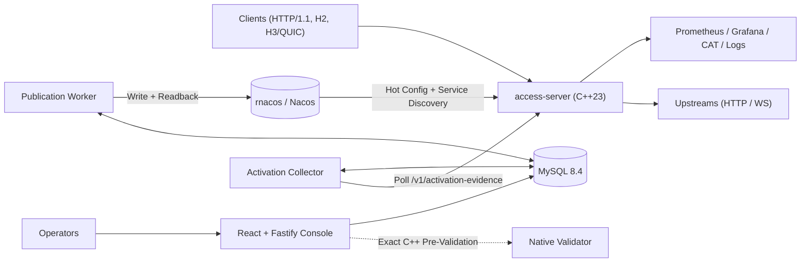
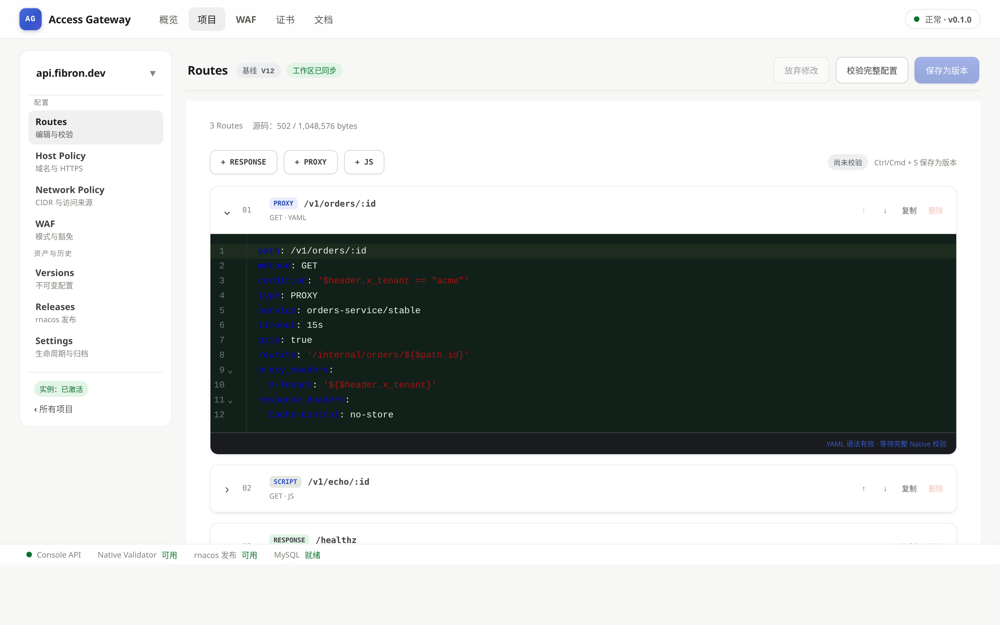
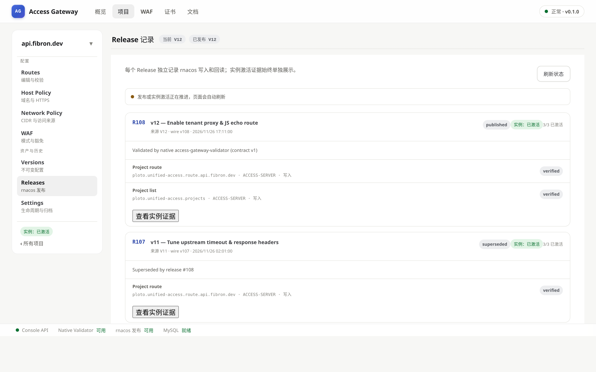
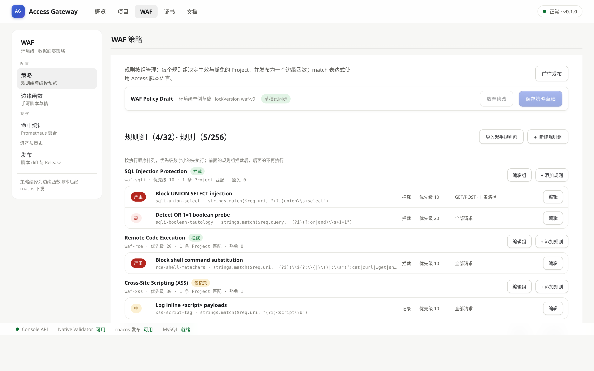
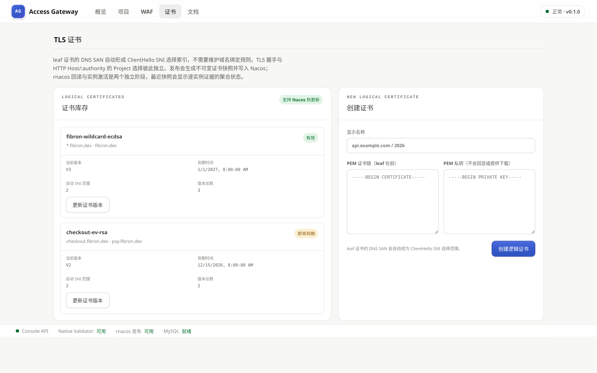

# Fibron

**High-performance C++23 HTTP/1.1, HTTP/2 & HTTP/3 gateway with compiled JS edge functions, built-in WAF, and verifiable release activation.** _(formerly Access Gateway)_

[](https://github.com/fiber-net-gateway/access-gateway/actions/workflows/ci.yml)
[](https://github.com/fiber-net-gateway/access-gateway/pkgs/container/access-server)
[](LICENSE)
[](native/CMakeLists.txt)
[](#listeners-and-protocols)

English | [简体中文](README.zh-CN.md)

Fibron is a self-hosted, production-tested HTTP gateway made of two tightly integrated parts:

- **`access-server`** — a C++23 data plane built on the
  [Fiber](https://github.com/fiber-net-gateway/fiber-gateway-cpp) coroutine/EventLoop framework. It
  terminates HTTP/1.1, HTTP/2, and HTTP/3 (QUIC) traffic, evaluates compiled routing/WAF/edge
  scripts, and proxies HTTP and WebSocket workloads with ~4–6 MiB baseline RSS.
- **The Console** — a React and Fastify control plane where teams author, validate (using the exact
  C++ data-plane compiler), publish, and roll back configuration—then **prove** which live
  instances are actually serving it.



## Console Preview

| Route Editor (YAML & Compiled JS)                      | Release & Per-Instance Activation Evidence                        |
| ------------------------------------------------------ | ----------------------------------------------------------------- |
|  |  |
| **WAF Policy (Compiled to Edge Functions)**            | **TLS Certificate Inventory & Automatic SNI**                     |
|       |            |

---

## Why Fibron?

| Capability                  | Fibron                                                                                          | Typical Self-Hosted Gateways                               |
| --------------------------- | ----------------------------------------------------------------------------------------------- | ---------------------------------------------------------- |
| **Protocols**               | Native HTTP/1.1, HTTP/2 (ALPN), HTTP/3 (QUIC), WebSocket tunneling                              | Often H1/H2 only, or HTTP/3 experimental                   |
| **Edge Functions & WAF**    | Compiled JS-like bytecode VM inside C++23 (no V8/Node/LuaJIT); WAF compiles into edge functions | External plugins, Lua/WASM overhead, or separate WAF layer |
| **Pre-Publish Validation**  | Console invokes the exact C++ `access-gateway-validator` binary before creating a Release       | Control plane re-implements schema checks and drifts       |
| **Activation Verification** | Explicitly separates **Draft → Published → Active** via authenticated per-instance polling      | Assumes "written to config store" means "live everywhere"  |
| **Hot-Path Contention**     | Worker-sharded EventLoop SWRR + immutable pinned snapshots (zero hot-path config locks)         | Global locks or GC pauses under high-fanout traffic        |
| **Certificate Management**  | Automatic SNI routing derived from leaf DNS SANs; atomic snapshot swap; encrypted at rest       | Manual SNI-to-cert bindings that drift on renewal          |

## Performance Highlights

Reproducible native microbenchmarks (`Release + LTO`, pinned to 4 CPU cores on an Intel i7-13700H;
run locally with `npm run benchmark:native`). See [Benchmarks](docs/benchmarks.en.md) and the full
[benchmark baselines](native/access-server/docs/benchmark-baselines.md) for methodology, manifests,
and caveats.

| Benchmark Path                                    | Throughput       | p50 Latency | Notes                                             |
| ------------------------------------------------- | ---------------- | ----------- | ------------------------------------------------- |
| **Worker-sharded SWRR service selection** (4w)    | **52.7M ops/s**  | `19.0 ns`   | **9.23x–10.12x** faster than shared-mutex SWRR    |
| **SNI TLS certificate lookup** (wildcard / exact) | **34.1–35.1M/s** | `28.5 ns`   | Lock-free, zero-allocation ClientHello selection  |
| **Route lookup** (352 projects, 1,056 routes, 4w) | **21.8M ops/s**  | `45.9 ns`   | Pinned immutable snapshot per request             |
| **Static template rendering**                     | **>500M ops/s**  | `1.7 ns`    | `0` heap allocations / `0` bytes allocated        |
| **Batch publish** (352 projects compile + commit) | **344K proj/s**  | `1.02 ms`   | **79.8x** faster than sequential project commits  |
| **Benchmark process RSS**                         | —                | —           | **3.8–6.5 MiB** max RSS across core routing paths |

> [!NOTE]
> Microbenchmarks measure hot-path overhead and scaling regressions in isolation; they do not
> substitute for end-to-end production capacity profiling.

---

## 60-Second Quick Start (Prebuilt Docker Demo)

Run the full stack—Console, API, publication worker, activation collector, MySQL 8.4, R-Nacos, and
`access-server`—with **zero local compilation** (requires only `git`, `openssl`, and Docker
Compose):

```bash
git clone --depth 1 https://github.com/fiber-net-gateway/access-gateway.git
cd access-gateway
./deploy/demo/init-env.sh                     # generate local secrets & self-signed cert
docker compose -f compose.prebuilt.yaml up -d # pull prebuilt GHCR image and start stack
```

Compose applies migrations, uploads the demo TLS certificate, publishes a TLS snapshot and a demo
Project through the Console, and starts `access-server` once both are live in R-Nacos.

| Service             | Address                                                         |
| ------------------- | --------------------------------------------------------------- |
| Console             | `http://localhost:8088`                                         |
| Gateway HTTPS/HTTP2 | `curl -k --http2 -H 'Host: demo.local' https://localhost:8443/` |
| Gateway plaintext   | `curl -H 'Host: demo.local' http://localhost:8000/`             |
| Metrics             | `http://localhost:8001/metrics`                                 |
| R-Nacos console     | `http://localhost:10848/rnacos/`                                |
| MySQL               | `127.0.0.1:3307`                                                |

Credentials are written to the ignored local `.env` file. Stop the demo with
`docker compose -f compose.prebuilt.yaml down` (add `--volumes` to remove demo data).

<details>
<summary><strong>Build the Docker demo locally from source instead</strong></summary>

Requires Node.js 20.19+, CMake 4.1+, Ninja, and Clang 17+ / GCC 13+:

```bash
git clone --recurse-submodules https://github.com/fiber-net-gateway/access-gateway.git
cd access-gateway
npm install
npm run demo:init   # generate local secrets and a self-signed certificate
npm run demo:up     # compile native + console locally, then start the stack
```

`NATIVE_BUILD_JOBS` controls native build parallelism (default `2`). Operate with
`npm run demo:ps`, `npm run demo:logs`, and `npm run demo:down`.

</details>

<details>
<summary><strong>Testing HTTP/3 from a Windows browser under WSL2</strong></summary>

Use the WSL IP from `hostname -I` (WSL2 usually forwards TCP but not UDP from Windows `localhost`).
Map that IP to `demo.local` in your Windows hosts file and trust `deploy/demo/certs/demo.crt` for
local testing only. Set `ACCESS_SERVER_PUBLISHED_HOST=127.0.0.1` in `.env` to keep the gateway
inside WSL.

</details>

---

## Project Status

Fibron's data plane runs in production serving live traffic, and both data plane and control plane
remain under active development.

- **Data plane (`access-server`):** serving production traffic. Changes remain gated by the native
  test suites and wire-compatibility contracts; production script-corpus differential verification
  and final cutover gates are still tracked as open engineering milestones.
- **Control plane (Console):** includes MySQL migrations, RBAC, encrypted immutable versions,
  CodeMirror YAML/JS route editors, Native Validator integration, TLS snapshots, WAF & edge
  function authoring, Release state machine, leased rnacos publication worker, and activation
  evidence collector. Currently only local development admin auth and local document encryption keys
  are available (`AUTH_MODE=oidc` fails closed until an OIDC provider adapter is implemented).

See [Known limitations](#known-limitations) for the complete, transparent list.

---

## Data Plane Features

### Listeners and protocols

| Listener       | Default            | Serves                                                     |
| -------------- | ------------------ | ---------------------------------------------------------- |
| Gateway TLS    | `0.0.0.0:8443/tcp` | HTTPS, with HTTP/1.1 and HTTP/2 negotiated through ALPN    |
| Gateway HTTP/3 | `0.0.0.0:8443/udp` | HTTP/3 over QUIC, advertised with `Alt-Svc`                |
| Plaintext      | `0.0.0.0:8000/tcp` | HTTP/1.1, alongside TLS or as the only traffic listener    |
| Status         | `0.0.0.0:8001`     | Prometheus `/metrics` and optional activation evidence API |

HTTP worker count follows process CPU affinity and cgroup v1/v2 quota automatically.

### Projects and hosts

A Project owns a set of Host patterns and an ordered list of routes. Hosts are matched
case-insensitively after removing the port and one trailing dot, and each pattern belongs to exactly
one Project.

| Pattern         | Example           | Matches                                                  |
| --------------- | ----------------- | -------------------------------------------------------- |
| Exact           | `api.example.com` | That host only                                           |
| Suffix wildcard | `*.example.com`   | `a.example.com` and `a.b.example.com`, not `example.com` |
| Global wildcard | `*`               | Any valid host                                           |

Project selection uses HTTP `Host` or `:authority`. It is independent of TLS SNI, so one
certificate can serve several Projects and vice versa.

### Route matching

Routes match on path structure first, then on an optional method and compiled `condition`
expression reading `$path`, `$query`, `$header`, `$cookie`, `$context`, `$req`, and `$conn`:

| Path form      | Example         | Captures                       |
| -------------- | --------------- | ------------------------------ |
| Static segment | `/users/me`     | Nothing                        |
| Parameter      | `/users/:id`    | One segment, as `$path.id`     |
| Tail wildcard  | `/assets/*rest` | The remainder, as `$path.rest` |

Static segments beat parameters, and parameters beat wildcards. Candidates on the same path are
tried in configured order.

```yaml
path: /api/orders/:id
method: GET
condition: '$header.x_tenant == "acme"'
type: PROXY
service: orders/stable
```

### Route types

**RESPONSE** answers directly from the gateway with no upstream (`TEXT`, compile-time decoded
`BASE64`, or per-request `${...}` `TEMPLATE`):

```yaml
path: /healthz
method: GET
type: RESPONSE
status: 200
body:
  type: TEXT
  content: ok
response_headers:
  Content-Type: text/plain; charset=utf-8
```

**PROXY** forwards to an upstream service with templated path rewriting and headers:

```yaml
path: /api/orders/:id
type: PROXY
service: orders/stable
timeout: 30s
rewrite: '/internal/orders/${$path.id}'
proxy_headers:
  X-Tenant: '${$header.x_tenant}'
response_headers:
  Cache-Control: no-store
```

**SCRIPT** runs a JavaScript-like program compiled at configuration load time. Scripts can read
requests and JSON/binary bodies, set headers/cookies, send responses, and call fixed HTTP backends
via an `http` directive. Standard libraries cover strings, arrays, binary, hashes, math,
randomness, JSON, and URLs. (Not Node.js: no filesystem, timers, modules, or user-defined
functions.)

<!-- prettier-ignore -->
```javascript
return {
    id: $path.id,
    method: $req.method,
    source: $query.source || "unknown"
};
```

### Proxying

- **Upstreams:** NamingService discovery (`service`, optional `/cluster` suffix) or static
  `addresses`. Discovery selects enabled, healthy, positively weighted instances and prefers the
  local zone.
- **Load balancing:** worker-sharded smooth weighted round robin (SWRR) with a shared per-endpoint
  circuit breaker.
- **Retries:** failed connections re-select up to 4 attempts only before sending the request head,
  preventing duplicate delivery.
- **Connections:** connection pooling, bounded DNS resolver (no implicit public fallback), and Happy
  Eyeballs under a single connect deadline.
- **Rewriting:** templated `rewrite`, `proxy_headers`, and `response_headers`, preserving original
  URI and percent-encoding when no rewrite is set. `Location` and `Refresh` rewrite automatically
  unless overridden.
- **Streaming & WebSocket:** bidirectional body streaming (`flush: true` for SSE / slow uploads) and
  raw-byte HTTP/1.1 WebSocket tunneling via `websocket_timeout`.
- **Limits:** per-route `max_client_body_size`, `max_proxy_body_size`, and `timeout` (server
  defaults: 400 MiB request / 600 MiB response).

### Upstream TLS

The process default is `ACCESS_SERVER_UPSTREAM_TLS_MODE` (`legacy_insecure`, `system_ca`, or
`custom_ca`—use a verifying mode in production). Any `PROXY` route can override it with an immutable
`upstream_tls` profile specifying verification mode, inline CA, SNI, verification name, and mTLS
client certificate referenced by Console certificate version UUID (so private keys never appear in
route configs).

### Response compression

`gzip: true` (level 6) or `gzip: 1`–`9` works on any route type. Static `TEXT` and `BASE64` bodies
precompress at compile time; dynamic responses stream-compress with `Accept-Encoding` negotiation,
fixed MIME allow-list, `Vary` merging, and `406` on full refusal.

### Access policies

| Policy         | Scope | Behavior                                                                             |
| -------------- | ----- | ------------------------------------------------------------------------------------ |
| HTTPS redirect | Host  | Redirects with 301, 302, 307, or 308 and sends `Strict-Transport-Security`           |
| Entry network  | Host  | Rejects with 403 unless the instance entry (`vdi`, `desktop`, `internet`) is allowed |
| Source CIDR    | Route | `allows` holds allow and `!deny` entries (IPv4/IPv6); deny wins, 403                 |
| Request body   | Route | Rejects oversized bodies with 413 for both declared and streamed lengths             |

Behind a reverse proxy, client IP and scheme follow `ACCESS_SERVER_CLIENT_METADATA_MODE`: `direct`
(default, ignores forwarding headers), `trusted_proxy` (parses `Forwarded` / `X-Forwarded-For` /
`X-Real-Ip` only for `ACCESS_SERVER_TRUSTED_PROXY_CIDRS`), or `legacy_headers` (Java compatibility
mode; never expose to untrusted clients).

### Gray release and clusters

Gray rules in `ploto.unified-access.gray-match` map an entry network to a ratio (out of 10,000) and
CIDR list, routing matches to the `gray` cluster. With `ACCESS_SERVER_TEST_MODE=true`,
`api_gray.example.com` routes as `api.example.com` in cluster `gray`, and `HI-TRACE-CLUSTER` selects
a cluster when the host names none.

### Edge functions

Edge functions are compiled scripts mounted on Projects that inspect requests and short-circuit
responses before normal routing. They power the built-in WAF and can also be handwritten.

- **Phases:** `request_head` runs before route matching (protecting unmatched paths); `request_body`
  runs after matching on `PROXY` routes with `edge_function_body: true` (JSON, form, text, XML; 1
  MiB cap).
- **Mounting & Canary:** project `include`/`exclude` globs, `priority`, sticky client-IP sampling
  `ratio`, and mutually exclusive version canary via `replaces` (remove the new function to roll
  back cleanly).
- **Capabilities & Safety:** read-only request inspection, early `resp.*` responses,
  `ctx.report(event, label)` metrics/logs, `cidr` directive, RE2 regex matching (no catastrophic
  backtracking), fail-open by default (`ACCESS_SERVER_EDGE_FUNCTION_FAIL_CLOSE=true` for 503).

```javascript
directive office = cidr "10.0.0.0/8;172.28.1.0/24";

if (!office.contains($conn.remote_addr) && strings.match($req.uri, "(?i)union\\s+select")) {
  ctx.report("waf.block", "sqli-0023");
  resp.send(403, "blocked");
}
```

### Hot configuration updates

Routes, Project lists, gray rules, TLS certificates, and edge functions all update without restart:

- Candidates are fully parsed and compiled before replacing the running snapshot.
- Invalid or oversized candidates are rejected while the last-known-good snapshot keeps serving.
- Same-version candidates are ignored; in-flight requests finish on the snapshot they started with.
- Removing a Project unloads it cleanly (distinct from a failed update).
- Certificates resolve at `ClientHello` via leaf DNS SANs and rotate atomically.

### Observability & Upgrades

- **Prometheus & Grafana:** fixed-schema bounded metrics with LRU eviction for dynamic families
  ([bounded metrics](native/access-server/docs/bounded-metrics.md)) plus two ready-to-use dashboards
  in [`deploy/grafana/`](deploy/grafana/) (Request Handling and Runtime Health).
- **Tracing & Logging:** CAT request trees, `HI-TRACE-ID`, W3C `traceparent`/`tracestate`,
  asynchronous rotating access logs (100 MB, drop-on-full without backpressure), and structured edge
  function event logs.
- **Prewarmed Upgrades:** `access-server-boss` and `access-serverctl` spin up and sync a new
  generation before handing off TCP listeners
  ([upgrade guide](docs/access-server-prewarm-upgrade-design.md)).

---

## Console Features

- **Projects & Routes:** per-route CodeMirror YAML and JavaScript editors, drag/keyboard reordering,
  live native wire preview, and native resource limit indicators.
- **Immutable Versions:** AES-256-GCM envelope-encrypted configuration versions protected by
  `If-Match` optimistic locking and idempotency keys.
- **Host & Network Policy:** primary domain, exact host aliases, HTTPS redirect modes, and
  Project-wide allow/deny CIDR policies compiled into every route.
- **Three-Stage Validation:** syntax → cross-resource semantics → full compilation by the C++
  **Native Validator** binary (required to create a Release).
- **Releases & Drift-Safe Publication:** immutable Releases, leased worker writing and readback per
  rnacos Data ID, drift conflict detection, explicit Project decommission Releases, and rollback as
  a new Release.
- **Activation Evidence:** independent collector polling `/v1/activation-evidence` per instance and
  aggregating `active`, `pending`, `degraded`, and `unknown` states onto each Release.
- **TLS Certificates:** encrypted inventory (`valid` / `expiring` / `expired` / `superseded`), no
  private-key download API, automatic SNI-from-SAN preview, SAN-change confirmation on renewal, and
  atomic TLS Releases.
- **WAF & Handwritten Edge Functions:** rule groups (`off` / `log` / `block`), Project overrides,
  6-group starter pack (SQLi, RCE, XSS, path traversal, probing, malformed requests), native compile
  and release-diff previews, Prometheus hit statistics (`1h`/`24h`/`7d`), and version canary
  promotion.
- **RBAC, Audit & Built-in Docs:** `admin`, `maintainer`, `publisher`, and `auditor` roles; redacted
  audit trails; bilingual route/script docs served at `/docs`.

---

## Known Limitations

**Console**

- OIDC is not implemented yet, so production login is unavailable. Local document encryption keys
  are for development only; production requires an external KMS provider (not yet implemented).
- Gray rules and Host entry-network restrictions are authored directly in rnacos rather than in the
  Console UI.
- Failed or partial publications are terminal (no automatic per-resource retry; recover by creating
  a new Release).
- TLS Releases do not yet have one-click rollback like WAF Releases.
- Audit events are persisted to MySQL, but an audit viewer UI/API is not built yet.
- Role memberships have no management UI/API yet.
- Removed edge function script Data IDs remain in rnacos as harmless orphans.

**Data plane**

- Upstream connections use HTTP/1.1 only, and WebSocket requires an HTTP/1.1 client upgrade.
- JavaScript routes reject unknown-length request bodies with 413, and their `http` directive does
  not resolve NamingService upstreams.
- Edge functions cannot mutate requests, and the script VM has no instruction budget (protected by
  static language restrictions and input caps).
- `/metrics` has no authentication; bind the status listener to a private network.
- Changing DNS resolver config, process CA bundle, or activation token requires a rolling restart.

---

## Development

### Prerequisites

- **Console:** Node.js 20.19+ (npm workspaces).
- **Native (Linux):** CMake 4.1+, Ninja, and Clang 17+ or GCC 13+ with C++23 support.

Clone with `--recurse-submodules` (or run `git submodule update --init --recursive`). Do not run
`git submodule update --remote`; Fiber is pinned deliberately.

### Console

```bash
npm install
cp server/.env.example server/.env
npm run dev
```

Starts Console at `http://localhost:5173` and API at `http://127.0.0.1:3000`. To enable MySQL
persistence, configure `MYSQL_ENABLED=true`, `MYSQL_PASSWORD`, and `DOCUMENT_ENCRYPTION_KEY_BASE64`
(`openssl rand -base64 32`) in `server/.env`, then run `npm run db:migrate && npm run dev`. See
[`server/.env.example`](server/.env.example) and
[`deploy/demo/bootstrap-console.mjs`](deploy/demo/bootstrap-console.mjs) for full setup details.

### Native

```bash
npm run configure:native
npm run build:native             # native/build/apps/access-server
npm run build:native-validator   # native/build/apps/access-gateway-validator
npm run test:native
```

Additional native commands: `npm run test:native:sanitizers`, `npm run test:native:interop`,
`npm run benchmark:native`, and `npm run verify:native:cutover`.

### Running `access-server` standalone

```bash
cp native/access-server/access-server.env.example access-server.env
# Set NACOS_SERVER_ADDRESSES and ACCESS_SERVER_NETWORK_ENTRY.
./native/build/apps/access-server access-server.env
```

Startup is fail-closed: `access-server` waits for valid initial configuration (and valid TLS
certificates when TLS is enabled), binds listeners, registers in Nacos, and begins serving only
after registration succeeds. See
[`access-server.env.example`](native/access-server/access-server.env.example) for all settings.

---

## Origin, Wire Contract & Compatibility

Fibron's data plane originated as a production C++23 migration of the Java `ploto-unified-access`
gateway and preserves its rnacos wire contract:

| Purpose                 | Data ID                                     | Group           |
| ----------------------- | ------------------------------------------- | --------------- |
| Project list            | `ploto.unified-access.projects`             | `ACCESS-SERVER` |
| Project route           | `ploto.unified-access.route.<project>`      | `ACCESS-SERVER` |
| TLS certificates        | `ploto.unified-access.tls-certificates`     | `ACCESS-SERVER` |
| Edge function index     | `ploto.unified-access.edge-functions`       | `ACCESS-SERVER` |
| Edge function script    | `ploto.unified-access.edge-function.<name>` | `ACCESS-SERVER` |
| Gray rules              | `ploto.unified-access.gray-match`           | `DEFAULT_GROUP` |
| Test cluster allow-list | `ploto.test.temp-cluster-apps`              | `DEFAULT_GROUP` |

The Project list is a semicolon-separated string; the native codec is the source of truth for
accepted fields and defaults.

## Repository Layout

```text
access-gateway/
├── native/access-server/           # C++23 data plane, validator, tests, and native docs
├── server/                         # Fastify control-plane API, publication worker, collector
├── web/                            # React and Vite management console
├── deploy/                         # Dockerfile, demo bootstrap, Grafana dashboards
├── docs/                           # Architecture, design docs, benchmarks, and user guides
├── third_party/fiber-gateway-cpp/  # Pinned, read-only Fiber submodule
├── .github/                        # CI, GHCR publishing workflows, and issue/PR templates
└── AGENTS.md                       # Repository conventions and validation matrix
```

## Documentation

**Start here**

- [Architecture and principles (English)](docs/architecture.en.md) |
  [架构与原理 (简体中文)](docs/architecture.md)
- [Performance benchmarks (English)](docs/benchmarks.en.md) |
  [性能基准与复现契约 (简体中文)](native/access-server/docs/benchmark-baselines.md)
- [User guide index](docs/user-guide/README.md) (EN & ZH):
  [routing](docs/user-guide/en/routing.md), [script routes](docs/user-guide/en/script-routing.md),
  [script reference](docs/user-guide/en/script-reference.md)

**Design & Data Plane**

- [Edge functions and WAF](docs/edge-functions-and-waf-design.md)
- [Instance activation evidence](docs/activation-evidence.md)
- [Network policy and certificates](docs/network-policy-and-certificate-design.md)
- [Prewarm upgrade](docs/access-server-prewarm-upgrade-design.md)
- [Access Server guide](native/access-server/README.md),
  [compatibility contract](native/access-server/docs/compatibility-contract.md),
  [bounded metrics](native/access-server/docs/bounded-metrics.md), and
  [upstream provenance](native/access-server/UPSTREAM.md)

## Contributing

Contributions are welcome! See [CONTRIBUTING.md](CONTRIBUTING.md) and [AGENTS.md](AGENTS.md) for
build/test commands, coding conventions, and open areas where help is most impactful (OIDC login,
audit log UI, gray rule editor, Helm chart, and standalone file-config mode).

## License

Licensed under the [Apache License 2.0](LICENSE). The migrated application retains its
[upstream license notice](native/access-server/LICENSE.upstream).
