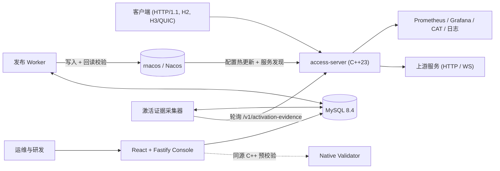
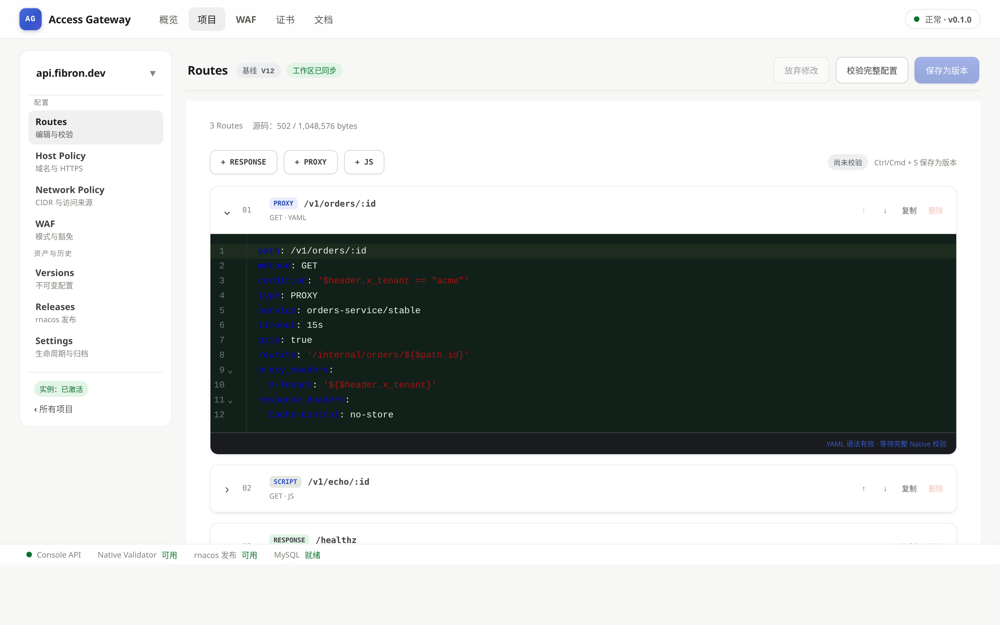
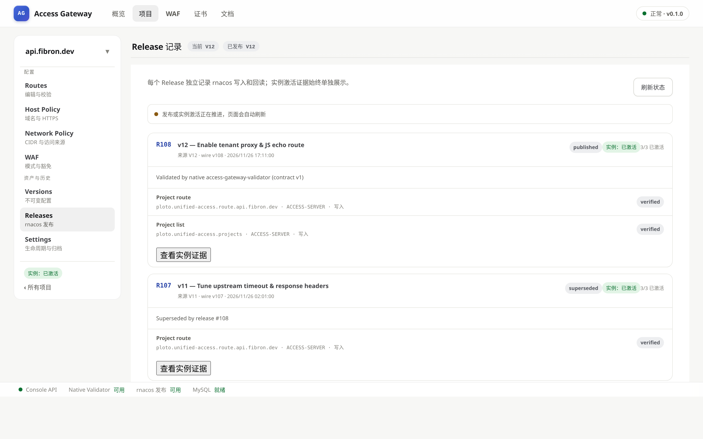
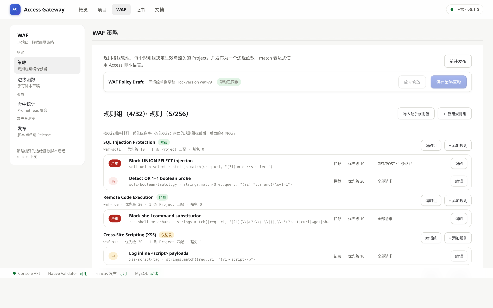
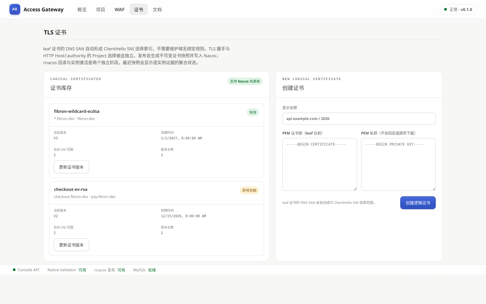

# Fibron

**高性能 C++23 HTTP/1.1、HTTP/2 与 HTTP/3 网关，内置编译期 JS 边缘函数、WAF 与可验证的实例生效控制面。** _（原 Access Gateway）_

[](https://github.com/fiber-net-gateway/access-gateway/actions/workflows/ci.yml)
[](https://github.com/fiber-net-gateway/access-gateway/pkgs/container/access-server)
[](LICENSE)
[](native/CMakeLists.txt)
[](#监听器与协议)

[English](README.md) | 简体中文

Fibron 是一个面向生产环境的自托管 HTTP 网关，由紧密协同的两部分组成：

- **`access-server`** —— 基于 [Fiber](https://github.com/fiber-net-gateway/fiber-gateway-cpp) 协程/EventLoop 框架的 C++23 数据面，负责终结 HTTP/1.1、HTTP/2 和 HTTP/3（QUIC）流量，执行编译后的路由/WAF/边缘脚本，并代理 HTTP 与 WebSocket 流量（核心基准 RSS 约 4–6 MiB）。
- **Console** —— 基于 React 和 Fastify 的控制面，用于编写、校验（直接调用与数据面同一份 C++ 编译器）、发布和回滚配置，并通过逐实例采集**证明**哪些实例真正运行着这份配置。



## 控制台界面预览

| 路由编辑器（YAML 与编译期 JS）                       | Release 与逐实例激活证据                                   |
| ---------------------------------------------------- | ---------------------------------------------------------- |
|  |  |
| **WAF 策略（编译为边缘函数）**                       | **TLS 证书库存与自动 SNI 解析**                            |
|       |         |

---

## 为什么选择 Fibron？

| 维度                 | Fibron                                                                            | 常见自托管网关                             |
| -------------------- | --------------------------------------------------------------------------------- | ------------------------------------------ |
| **协议支持**         | 原生 HTTP/1.1、HTTP/2（ALPN）、HTTP/3（QUIC）与 WebSocket 隧道                    | 仅 H1/H2，或 HTTP/3 处于实验阶段           |
| **边缘函数与 WAF**   | C++23 内置类 JS 字节码 VM（无 V8/Node/LuaJIT 开销）；WAF 规则直接编译为边缘函数   | 依赖外部插件、Lua/WASM 开销或独立 WAF 层   |
| **发布前权威校验**   | Console 直接调用 C++ `access-gateway-validator` 校验通过后才允许创建 Release      | 控制面重复实现校验逻辑，容易与数据面漂移   |
| **实例生效证明**     | 显式区分 **草稿（Draft）→ 已发布（Published）→ 已生效（Active）**，逐实例采集证据 | 将“写入配置中心成功”直接等同于“线上已生效” |
| **高并发无锁热路径** | Worker 分片 EventLoop SWRR + 不可变请求固定快照（请求热路径读取配置零锁）         | 高扇出场景下的全局锁竞争或 GC 停顿         |
| **证书自动 SNI**     | 自动由 leaf 证书 DNS SAN 构建 SNI 索引，原子快照切换，数据库信封加密存储          | 人工维护域名与证书绑定，续期易漏配         |

## 核心性能指标

以下为可复现的 native 微基准数据（`Release + LTO`，Intel i7-13700H 绑定 4 核；本地运行 `npm run benchmark:native`）。完整测试方法、环境摘要与边界说明见[性能基准与复现契约](native/access-server/docs/benchmark-baselines.md)和[英文摘要](docs/benchmarks.en.md)。

| 基准路径                                    | 吞吐             | p50 延迟  | 说明                               |
| ------------------------------------------- | ---------------- | --------- | ---------------------------------- |
| **Worker 分片 SWRR 负载均衡选择**（4 核）   | **52.7M ops/s**  | `19.0 ns` | 较共享锁实现提升 **9.23x–10.12x**  |
| **SNI TLS 证书查找**（精确 / 通配符）       | **34.1–35.1M/s** | `28.5 ns` | ClientHello 热路径无锁、零内存分配 |
| **路由匹配**（352 项目 / 1,056 路由，4 核） | **21.8M ops/s**  | `45.9 ns` | 请求开始时固定不可变快照           |
| **静态模板渲染**                            | **>500M ops/s**  | `1.7 ns`  | `0` 次堆分配 / `0` 字节分配        |
| **批量配置发布**（352 项目编译 + 提交）     | **344K proj/s**  | `1.02 ms` | 较逐项目提交快 **79.8x**           |
| **核心路由基准进程内存（Max RSS）**         | —                | —         | **3.8–6.5 MiB**                    |

> [!NOTE]
> 微基准用于衡量热路径开销和发现扩展性回归，不能替代端到端生产容量压测。

---

## 60 秒快速体验（预构建 Docker 演示）

无需本地编译 C++23 或安装 Node.js，仅需 `git`、`openssl` 和 Docker Compose 即可拉起完整演示环境（Console、API、发布 Worker、激活采集器、MySQL 8.4、R-Nacos 与 `access-server`）：

```bash
git clone --depth 1 https://github.com/fiber-net-gateway/access-gateway.git
cd access-gateway
./deploy/demo/init-env.sh                     # 生成本地密钥与自签名证书
docker compose -f compose.prebuilt.yaml up -d # 拉取预构建 GHCR 镜像并启动全栈
```

Compose 会自动执行数据库 migration、上传演示证书、通过 Console 发布 TLS 快照和演示 Project，并在两者就绪后启动 `access-server`。

| 服务             | 地址                                                            |
| ---------------- | --------------------------------------------------------------- |
| Console          | `http://localhost:8088`                                         |
| 网关 HTTPS/HTTP2 | `curl -k --http2 -H 'Host: demo.local' https://localhost:8443/` |
| 网关明文         | `curl -H 'Host: demo.local' http://localhost:8000/`             |
| 指标             | `http://localhost:8001/metrics`                                 |
| R-Nacos 控制台   | `http://localhost:10848/rnacos/`                                |
| MySQL            | `127.0.0.1:3307`                                                |

本地凭据位于被忽略的 `.env` 文件中。停止环境执行 `docker compose -f compose.prebuilt.yaml down`（追加 `--volumes` 可清理全部演示数据）。

<details>
<summary><strong>从源码在本地构建 Docker 演示环境</strong></summary>

需要 Node.js 20.19+、CMake 4.1+、Ninja 和 Clang 17+ / GCC 13+：

```bash
git clone --recurse-submodules https://github.com/fiber-net-gateway/access-gateway.git
cd access-gateway
npm install
npm run demo:init   # 生成本地密钥和自签名证书
npm run demo:up     # 本地编译 native + console，然后启动全栈
```

可通过 `NATIVE_BUILD_JOBS` 控制并行度（默认 `2`），日常操作使用 `npm run demo:ps`、`npm run demo:logs` 和 `npm run demo:down`。

</details>

<details>
<summary><strong>在 WSL2 下从 Windows 浏览器测试 HTTP/3</strong></summary>

使用 `hostname -I` 得到的 WSL 地址（WSL2 通常只转发 Windows `localhost` 的 TCP，不转发 UDP），将其映射到 Windows hosts 文件中的 `demo.local` 并信任 `deploy/demo/certs/demo.crt`（仅限本地测试）。在 `.env` 中设置 `ACCESS_SERVER_PUBLISHED_HOST=127.0.0.1` 可限制网关仅在 WSL 内部可达。

</details>

---

## 项目状态

Fibron 数据面已在生产环境承载真实流量，数据面和控制面均处于持续演进中：

- **数据面（`access-server`）**：已承载生产流量，每次变更受 native 测试套件和 wire 兼容契约门禁保护；生产脚本语料差分验证与最终切流门禁仍在持续补齐。
- **控制面（Console）**：已完成 MySQL migration、RBAC、不可变加密版本、CodeMirror YAML/JS 路由编辑、Native Validator 校验、TLS 快照、WAF 与手写边缘函数、Release 状态机、带租约发布 Worker 及激活证据采集器。当前仅支持本地开发管理员登录与本地文档密钥（`AUTH_MODE=oidc` 在接入 provider 适配器前会 fail-closed 拒绝启动）。

完整清单见[已知限制](#已知限制)。

---

## 数据面功能

### 监听器与协议

| 监听器      | 默认地址           | 提供                                       |
| ----------- | ------------------ | ------------------------------------------ |
| 网关 TLS    | `0.0.0.0:8443/tcp` | HTTPS，通过 ALPN 协商 HTTP/1.1 和 HTTP/2   |
| 网关 HTTP/3 | `0.0.0.0:8443/udp` | 基于 QUIC 的 HTTP/3，通过 `Alt-Svc` 发布   |
| 明文        | `0.0.0.0:8000/tcp` | HTTP/1.1，可与 TLS 并行，也可作为唯一监听  |
| 状态        | `0.0.0.0:8001`     | Prometheus `/metrics` 和可选的激活证据接口 |

HTTP worker 数量根据进程 CPU affinity 和 cgroup v1/v2 配额自动确定。

### Project 与 Host

一个 Project 拥有一组 Host 模式和一个有序路由列表。Host 匹配不区分大小写（去除端口和一个末尾点），每个模式只能属于一个 Project：

| 模式     | 示例              | 匹配                                                     |
| -------- | ----------------- | -------------------------------------------------------- |
| 精确     | `api.example.com` | 仅该 Host                                                |
| 后缀通配 | `*.example.com`   | `a.example.com` 和 `a.b.example.com`，不含 `example.com` |
| 全局通配 | `*`               | 任意合法 Host                                            |

Project 由 HTTP `Host` 或 `:authority` 选择，与 TLS SNI 相互独立。

### 路由匹配

先按 Path 结构匹配（静态段 > 参数段 `:id` > 尾部通配段 `*rest`），同一路径节点按配置顺序判断 `method` 和编译期 `condition`（可访问 `$path`、`$query`、`$header`、`$cookie`、`$context`、`$req`、`$conn`）：

```yaml
path: /api/orders/:id
method: GET
condition: '$header.x_tenant == "acme"'
type: PROXY
service: orders/stable
```

### 路由类型

- **RESPONSE**：网关直接响应，支持 `TEXT`、`BASE64`（编译期解码）和 `TEMPLATE`（`${...}` 表达式）。
- **PROXY**：转发到 NamingService 服务或静态地址，支持 `rewrite`、`proxy_headers`、`response_headers` 模板、自动改写 `Location`/`Refresh`、双向流式转发（`flush: true`）和 HTTP/1.1 WebSocket 隧道。
- **SCRIPT**：配置加载时编译的类 JavaScript 脚本，支持请求与 JSON/二进制体读取、header/cookie 操作及 `http` directive 调用固定后端（非 Node.js，无文件系统、定时器或用户自定义函数）。

<!-- prettier-ignore -->
```javascript
return {
    id: $path.id,
    method: $req.method,
    source: $query.source || "unknown"
};
```

### 代理、上游 TLS 与压缩

- **服务发现与负载均衡**：优先本 zone 的健康正权重实例；worker 分片平滑加权轮询 + 跨 worker 共享逐 endpoint 熔断；请求头未发出前连接失败最多重选 4 次。
- **连接与 DNS**：连接池、有界 DNS resolver（无隐式公共 DNS 回退）、单一期限内的 Happy Eyeballs。
- **上游 TLS**：进程默认 `ACCESS_SERVER_UPSTREAM_TLS_MODE`（`legacy_insecure` / `system_ca` / `custom_ca`，生产请开启校验），路由可通过不可变 `upstream_tls` profile 覆盖并按证书版本 UUID 引用 mTLS 客户端证书（私钥不进入路由配置）。
- **Gzip 压缩**：任意路由支持 `gzip: true` 或 `1`–`9`；静态响应体编译期预压缩，动态与代理响应流式压缩。

### 访问策略、灰度与边缘函数

- **访问策略**：Host 级 HTTPS 重定向（HSTS）和入口网络控制（`vdi` / `desktop` / `internet`），Route 级 IPv4/IPv6 CIDR（`allows` / `!deny`，deny 优先）与请求体大小限制（413）。
- **客户端身份信任**：`ACCESS_SERVER_CLIENT_METADATA_MODE` 支持 `direct`（默认）、`trusted_proxy`（白名单 CIDR）和 `legacy_headers`（Java 兼容，不可暴露于公网）。
- **灰度与 cluster**：基于 `ploto.unified-access.gray-match` 按入口网络万分比和 CIDR 路由至 `gray` cluster；`ACCESS_SERVER_TEST_MODE=true` 支持 `api_gray.example.com` 和 `HI-TRACE-CLUSTER`。
- **边缘函数**：支持 `request_head`（路由匹配前）和 `request_body`（显式开启的 PROXY 路由，1 MiB 上限）两阶段、Project glob 挂载、按客户端 IP 粘性采样、基于 `replaces` 的互斥版本灰度、RE2 正则、默认 fail-open（`ACCESS_SERVER_EDGE_FUNCTION_FAIL_CLOSE=true` 改为 503）。

```javascript
directive office = cidr "10.0.0.0/8;172.28.1.0/24";

if (!office.contains($conn.remote_addr) && strings.match($req.uri, "(?i)union\\s+select")) {
  ctx.report("waf.block", "sqli-0023");
  resp.send(403, "blocked");
}
```

### 配置热更新、可观测性与升级

- **热更新**：路由、Project 列表、灰度、TLS 证书与边缘函数全量免重启原子切换；非法或超限候选失败保旧；进行中请求固定旧快照。
- **可观测性**：固定 schema 的 Prometheus 有界指标（[bounded metrics](native/access-server/docs/bounded-metrics.md)）、[`deploy/grafana/`](deploy/grafana/) 两套开箱即用面板、CAT 与 W3C `traceparent`/`tracestate` 链路追踪、异步不反压访问日志（100 MB 轮转）及结构化边缘函数事件日志。
- **预热升级**：`access-server-boss` 与 `access-serverctl` 预先同步新代配置再交接 TCP 监听（详见[预热升级设计](docs/access-server-prewarm-upgrade-design.md)）。

---

## Console 功能

- **Project 与路由编辑**：独立 CodeMirror YAML / JS 编辑器、拖拽与键盘排序、原生 wire 实时预览与资源限额提示。
- **不可变加密版本**：AES-256-GCM 信封加密、`If-Match` 乐观锁与幂等键，支持历史预览、恢复和直接发布。
- **三层权威校验**：语法 → 跨资源关系 → C++ **Native Validator** 全量编译校验（不可用时 fail-closed）。
- **Release 与防漂移发布**：不可变 Release、带租约发布 Worker 逐 Data ID 写入并回读、漂移冲突保护、显式下线 Release、回滚即创建新 Release。
- **激活证据**：独立采集器轮询 `/v1/activation-evidence`，聚合展示 `active` / `pending` / `degraded` / `unknown`，绝不将缺失证据渲染为成功。
- **TLS 证书管理**：加密库存、无私钥下载接口、基于 DNS SAN 的自动 SNI 预览、SAN 变更二次确认与原子 TLS Release。
- **WAF 与手写边缘函数**：规则组（`off`/`log`/`block`）、Project 覆盖、6 组 9 条内置起手规则包（SQLi/RCE/XSS/路径穿越/探测/畸形请求）、编译与发布 diff 预览、Prometheus 命中统计（`1h`/`24h`/`7d`）及灰度版本转正。
- **RBAC、审计与内置文档**：`admin`/`maintainer`/`publisher`/`auditor` 角色、脱敏审计事件、`/docs` 中英双语路由与脚本指南。

---

## 已知限制

**Console**

- OIDC 尚未实现，无法进行生产登录；本地文档密钥仅用于开发，生产需接入外部 KMS（尚未实现）。
- 灰度规则与 Host 入口网络限制暂未提供 Console 编辑界面，需直接在 rnacos 中维护。
- 失败或部分成功的发布为终态，无自动逐资源重试（通过新建 Release 恢复）。
- TLS Release 暂未提供 WAF Release 那样的一键回滚。
- 审计事件已落库，但尚无查询页面与 API；角色成员关系暂无管理页面与 API。
- 已删除边缘函数的脚本 Data ID 会作为无害孤儿留在 rnacos 中。

**数据面**

- 上游连接仅支持 HTTP/1.1，WebSocket 需客户端 HTTP/1.1 升级。
- JavaScript Route 拒绝未知长度请求体（413），其 `http` directive 不解析 NamingService 上游。
- 边缘函数不可改写请求，脚本 VM 无指令预算（目前依靠静态语言限制和输入上限保护）。
- `/metrics` 无鉴权，状态监听器须部署在私有网络。
- 修改 DNS resolver 文件、进程 CA bundle 或激活 token 需要滚动重启。

---

## 本地开发

### 环境要求

- **Console**：Node.js 20.19+（npm workspaces）。
- **Native（Linux）**：CMake 4.1+、Ninja，以及支持 C++23 的 Clang 17+ 或 GCC 13+。

克隆时请使用 `--recurse-submodules`（或执行 `git submodule update --init --recursive`），不要使用 `git submodule update --remote`。

```bash
# Console 开发模式（Web http://localhost:5173，API http://127.0.0.1:3000）
npm install
cp server/.env.example server/.env
npm run dev

# Native 构建与测试
npm run configure:native
npm run build:native
npm run build:native-validator
npm run test:native
```

运行独立 `access-server`：

```bash
cp native/access-server/access-server.env.example access-server.env
# 配置 NACOS_SERVER_ADDRESSES 和 ACCESS_SERVER_NETWORK_ENTRY
./native/build/apps/access-server access-server.env
```

更多配置、迁移与验证矩阵请参考 [`server/.env.example`](server/.env.example)、[`access-server.env.example`](native/access-server/access-server.env.example) 和 [AGENTS.md](AGENTS.md)。

---

## 起源与 rnacos 契约

Fibron 的数据面起源于 Java 网关 `ploto-unified-access` 的生产 C++23 迁移，并保留其 rnacos wire 契约：

| 用途                    | Data ID                                     | Group           |
| ----------------------- | ------------------------------------------- | --------------- |
| Project 列表            | `ploto.unified-access.projects`             | `ACCESS-SERVER` |
| Project 路由            | `ploto.unified-access.route.<project>`      | `ACCESS-SERVER` |
| TLS 证书                | `ploto.unified-access.tls-certificates`     | `ACCESS-SERVER` |
| 边缘函数索引            | `ploto.unified-access.edge-functions`       | `ACCESS-SERVER` |
| 边缘函数脚本            | `ploto.unified-access.edge-function.<name>` | `ACCESS-SERVER` |
| 灰度规则                | `ploto.unified-access.gray-match`           | `DEFAULT_GROUP` |
| 测试环境 cluster 白名单 | `ploto.test.temp-cluster-apps`              | `DEFAULT_GROUP` |

## 仓库结构

```text
access-gateway/
├── native/access-server/           # C++23 数据面、校验器、测试与文档
├── server/                         # Fastify 控制面 API、发布 Worker 与采集器
├── web/                            # React + Vite 管理控制台
├── deploy/                         # Dockerfile、演示 bootstrap、Grafana 面板
├── docs/                           # 架构、设计文档、性能基准与用户指南
├── third_party/fiber-gateway-cpp/  # 固定版本的只读 Fiber 子模块
├── .github/                        # CI、GHCR 镜像发布工作流与 Issue/PR 模板
└── AGENTS.md                       # 开发规范与验证矩阵
```

## 文档索引

**快速了解**

- [架构与原理（简体中文）](docs/architecture.md) | [Architecture & Principles (English)](docs/architecture.en.md)
- [性能基准与复现契约（简体中文）](native/access-server/docs/benchmark-baselines.md) | [Benchmarks (English)](docs/benchmarks.en.md)
- [用户指南索引](docs/user-guide/README.md)（中英双语）：[路由](docs/user-guide/zh-CN/routing.md)、[脚本路由](docs/user-guide/zh-CN/script-routing.md)、[脚本参考](docs/user-guide/zh-CN/script-reference.md)

**设计与数据面**

- [边缘函数与 WAF](docs/edge-functions-and-waf-design.md)
- [实例激活证据](docs/activation-evidence.md)
- [网络策略与证书](docs/network-policy-and-certificate-design.md)
- [预热升级](docs/access-server-prewarm-upgrade-design.md)
- [Access Server 指南](native/access-server/README.md)、[兼容契约](native/access-server/docs/compatibility-contract.md)、[有界指标](native/access-server/docs/bounded-metrics.md)、[上游来源](native/access-server/UPSTREAM.md)

## 参与贡献

欢迎提交 Issue 和 Pull Request！请阅读 [CONTRIBUTING.md](CONTRIBUTING.md) 和 [AGENTS.md](AGENTS.md) 了解构建测试命令与开发规范。目前最欢迎社区贡献的方向包括：OIDC 生产登录、审计日志查看界面、灰度规则编辑器、Helm Chart 和单机文件配置模式。

## 许可证

本项目采用 [Apache License 2.0](LICENSE) 许可。迁移的应用保留其[上游许可声明](native/access-server/LICENSE.upstream)。
