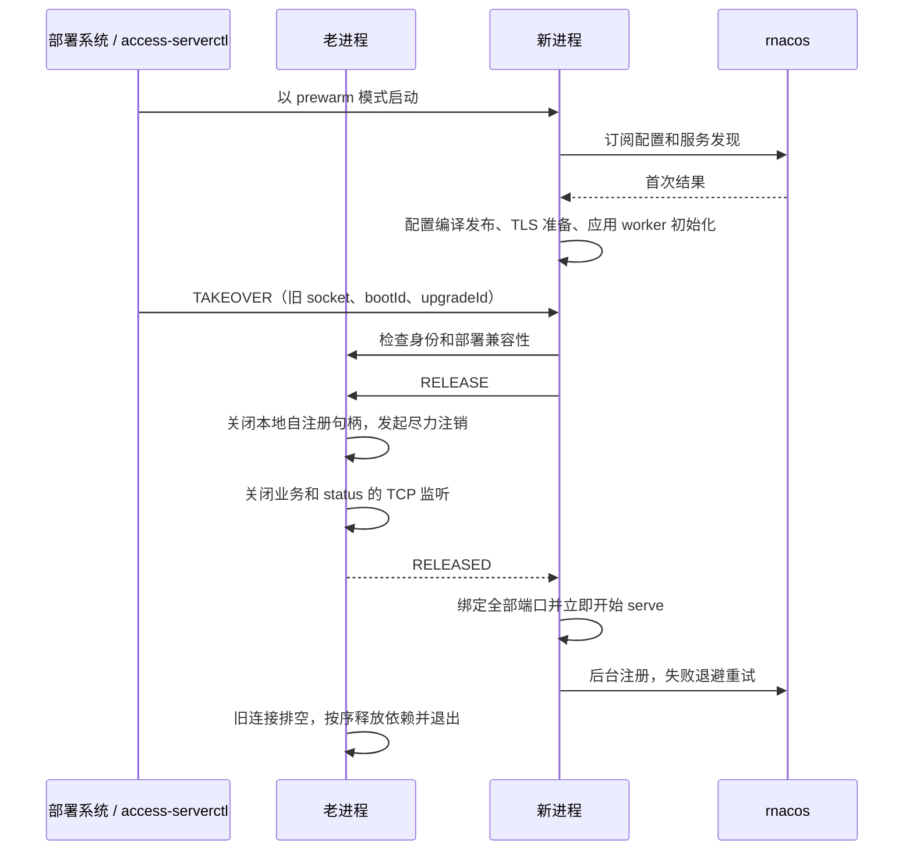

# Access Server 预热升级

本文记录当前实现和运维边界。目标是把首次 Nacos 配置同步和应用 worker 初始化移到老进程仍在服务的阶段，缩短入口停止接流量的窗口。重新绑定端口仍可能产生连接失败，不能据此宣称零停机或连接零损失。

## 1. 已确认的交接顺序



Nacos 注册交替不作为监听切换的同步门槛。旧进程只发起尽力注销，不等待远端成功确认；新进程开始接流量后再后台注册。UDS 回复只确认监听释放，不代表远端注销成功，也不代表旧连接已经结束。

此方案仅使用现有 Fiber API，不需要修改 Fiber、增加远端注销确认接口或更新依赖 gitlink。重复实例在具体 rnacos 版本上的可见性单独观测，不阻挡入口激活。

普通冷启动仍保留原有顺序：准备 → 绑定 → 注册成功 → serve。只有升级激活采用准备 → 绑定 → serve → 后台注册。升级注册失败会记录固定事件并以 100 ms 起步、最多 5 s 的退避重试，不撤下已经就绪的监听。成功后的连接恢复仍复用 NamingService 自带的重连机制；明确失败时再创建新的注册句柄。

## 2. 使用方式

先构建两个程序：

```bash
cmake --build native/build --target fiber_app_access_server fiber_app_access_serverctl --parallel
```

每个进程通过 `getpid()` 自动监听 `<control-dir>/<pid>.sock`，例如：

```text
/run/access-server/access-prod-0/23140.sock
/run/access-server/access-prod-0/23472.sock
```

由部署系统创建属于服务用户的私有目录，权限为 `0700`。进程创建的 socket 为 `0600`，控制客户端必须使用相同的有效 UID。目录应位于受信任的本机运行时文件系统，路径必须为绝对路径并满足 Unix socket 长度限制。同一目录中的进程应在同一 PID 命名空间内运行。

以下命令均由服务用户执行；已有老进程必须是支持本协议的版本：

```bash
# 初次部署：正常冷启动，同时提供后续升级使用的 UDS。
access-server /etc/access-server/generation-a.env \
  --control-dir=/run/access-server/access-prod-0

# 另一个受管理的进程：预热，不绑定业务/status 端口，不注册自身。
access-server /etc/access-server/generation-b.env \
  --start-mode=prewarm \
  --control-dir=/run/access-server/access-prod-0 \
  --prewarm-timeout-millis=120000

# PID 从进程管理器获取，示例值仅用于说明。
access-serverctl status --socket /run/access-server/access-prod-0/23472.sock
access-serverctl upgrade \
  --old-socket /run/access-server/access-prod-0/23140.sock \
  --new-socket /run/access-server/access-prod-0/23472.sock \
  --wait
```

`upgrade` 会先等待新进程报告 ready，再向新进程提交 TAKEOVER。`--wait` 等待交接成功或失败，注册尚未成功不会阻挡升级成功。没有 `--wait` 时返回任务接受状态，必须随后查询结果，不能把 accepted 当成已接流量。

```bash
# 停止服务进程：释放 TCP 监听后回复，随后自动排空并退出。
access-serverctl stop --socket /run/access-server/access-prod-0/23140.sock

# 放弃尚未发起交接的预热进程，或清理失败后的诊断进程。
access-serverctl abort --socket /run/access-server/access-prod-0/23472.sock
```

`SIGTERM` / `SIGINT` 仍关闭当前进程。`abort` 不取消正在进行的交接；监听释放后也不支持撤销或恢复旧监听。

预热总 deadline 默认为 120 s，可用上述参数设置为 1–3600000 ms。它覆盖控制面首次同步、应用 worker 初始化和辅助配置等待。预热完成后若 120 s 内没有发起交接，闲置新代会清理并退出。已接受的升级任务不依赖 CLI 存活；CLI 断开后可以继续查询状态。

CLI 控制调用有 deadline；超时或断线时结果可能未知。先查询双方状态，不能根据超时重复启动、强杀旧进程或者假定端口已释放。`--wait` 的交接观察期限为 30 s；它不取消进程内任务。

## 3. PREPARED 的含义

新进程必须满足：

- 本地配置、入口策略及上游 TLS 信任等必要检查成功。
- 按现有规则完成项目列表、项目 route 的首次同步、编译和 batch 发布；NamingService selector lease 完成首次 readiness。
- 启用 TLS 时已有合法证书快照及有效配置回调，并保留 bootstrap identity 到 listener 完成加载。
- 灰度订阅有至少一次合法结果；test mode 的临时集群白名单也有至少一次合法结果。NotFound/空结果依现有 codec 处理，未收到结果或传输错误不能当成空配置。
- AccessServer 及应用 worker 初始化成功，包括 DNS resolver、连接池和 metrics 资源。

升级期间保持正常订阅与更新：同版本忽略、非法候选保留旧快照、合法删除与卸载沿用既有规则。辅助配置在已有成功快照后拒绝新候选，不会抹掉已有就绪状态；订阅关闭或 shutdown 则撤销资格。交接前重新检查当前 readiness。

不主动访问所有业务上游，不执行用户脚本探活，不为所有服务预建连接。服务发现的合法空快照沿用当前语义，不额外要求每个服务至少有一个健康节点。

## 4. 状态与所有权

| 状态                  | 含义                                                     |
| --------------------- | -------------------------------------------------------- |
| preparing             | 本地资源和首次配置仍在准备                               |
| prepared + ready=true | 新代已准备，可发起交接；尚未绑定业务/status 端口         |
| activating            | 已确认旧监听释放，正在绑定和开始 serve                   |
| serving               | Server 已进入 Serving；后台注册可能仍为 pending/retrying |
| draining              | 旧代监听已释放，已有请求/连接仍可能存活                  |
| stopping              | 进入后续依赖清理                                         |
| stopped               | Runtime 资源已释放                                       |

控制状态同时报告 bootId、PID、升级任务 phase、稳定错误码和单独的 registration 状态。配置兼容性只暴露非敏感设置的摘要，不返回配置正文或凭据。

accept loop 拥有 UDS、交接任务和监听状态；Nacos loop 拥有注册与 watcher；HTTP worker 保持原有归属。注册关闭只等待本地任务取消和 owner-loop 处理，不等待远端注销结果。所有请求资源保留到旧连接排空后，再按依赖逆序释放 Nacos/CAT 等组件。

`AccessRuntimeCoordinator` 拆分 `prepare()` / `activate()`，普通 `start()` 组合执行。数据面 `prepare()` 完成应用资源初始化，`bind()` 建立监听。`begin_drain()` 立即停止全部 TCP listener，`shutdown()` 再等待连接和异步任务结束。metrics 响应排空不再阻挡业务 listener 释放。

Fiber 在 `Server::start()` 中仍会创建部分 endpoint/协议 worker；这些分配计入切换开销，不能声称收到回复后只执行一个 bind 系统调用。请求热路径没有新增控制状态检查、JSON 解析或锁。

## 5. 本地协议及交接检查

协议版本 1，四字节网络字节序长度前缀加 JSON，单帧最大 8 KiB、单个连接最多 64 个请求、最多 16 个连接。读写各有完整帧 2 s 的 deadline。Unix peer 使用 `SO_PEERCRED` 校验相同有效 UID。

| 命令     | 接收方                     | 行为                                                |
| -------- | -------------------------- | --------------------------------------------------- |
| STATUS   | 任一代                     | 查询有界状态                                        |
| TAKEOVER | prepared 新代              | 持有交接任务并联系旧代；先返回任务接受状态          |
| RELEASE  | serving 旧代               | 本地注销、关闭监听、回复 released，之后自动排空退出 |
| ABORT    | 未激活且无运行中任务的进程 | 回复后通知主生命周期清理退出                        |

除 STATUS 外要求 expectedBootId。交接同时校验旧代 bootId，防止 PID 复用后误操作。upgradeId 用于幂等；同一请求重试返回原任务状态，同 ID 不同参数或不同任务返回冲突。已失败的新代保留诊断状态，不接受另一次新任务，应 abort 后重新启动预热进程。

新代先建立与旧代的 UDS 连接，在同一连接完成状态检查和 RELEASE。应答丢失时，只接受匹配 bootId/upgradeId 的明确 released 状态作为恢复依据；连接失败、EOF 或端口探测失败均不是确认。

非阻塞目录锁阻止同一实例并发发起交接；旧代状态中记录它的前一代，在该代仍排空时拒绝第三代接管，避免无限叠加代际资源。进程管理器也应限制同一逻辑实例的并发预热进程数量；协议锁不能代替部署容量管理。

交接前比较业务/status 地址、TLS 与 test mode、入口、Nacos 环境及配置来源、注册地址策略等非敏感设置。固定端口必须一致；任一代 HTTP/3 开启或涉及 port 0 时不进行此交接。

进程正常清理仅删除自己记录的 socket inode；同名路径被替换后不会删除替代文件。启动遇到同 PID 的遗留 socket，只在确认归属且连接明确报告失效后清理；活跃 socket、普通文件和符号链接不会被直接覆盖。

## 6. 边界和故障处理

| 情况                                          | 行为                                                 |
| --------------------------------------------- | ---------------------------------------------------- |
| 预热失败/超时、旧 bootId 不符、配置关系不兼容 | 不释放旧监听                                         |
| 注册暂时失败                                  | 新代继续接流量，记录固定事件并退避重试               |
| 多端口绑定部分失败                            | 清理新代已经绑定的监听和资源，报告 ACTIVATION_FAILED |
| CLI 断开                                      | 已接受的任务继续；重新 STATUS 查询                   |
| RELEASE 应答无法确认                          | 报告 RELEASE_UNCONFIRMED，不擅自 bind                |
| 释放后激活失败                                | 不宣称旧监听恢复；需要部署恢复                       |
| 旧连接长期不结束                              | 保持 draining，不自动强杀，并拒绝后续代际升级        |

旧进程关闭监听是不可逆边界。当前 Fiber Server 一旦 stop 进入 Draining，不能原地重新 start。本阶段不提供旧进程恢复监听、FD 交接或 SO_REUSEPORT 重叠接管。部署恢复可能再次经历配置加载，不能承诺失败时始终保持入口可用。

首版支持同机、同网络命名空间内的 HTTP/1.1、TLS/HTTP/2 和建立在 TCP 上的 WebSocket。HTTP/3 的旧连接排空仍需要 UDP socket，因此独立设计；不能把 UDP 端口复用当作 QUIC 连接归属保证。仓库默认开启 HTTP/3，使用本功能需要明确关闭参与交接两代的 HTTP/3。

已有 accept 但尚在 TLS 握手、以及内核 accept 队列中尚未 accept 的连接，不在完整保留保证内。现有 HTTP/1 keep-alive、HTTP/2 GOAWAY 和 WebSocket 排空规则保持不变。

多代文件日志不得轮转同一 `access.log`。启用文件日志时，要求各代使用不同的既存目录；预检查通过目录 device/inode 识别共享路径。可关闭文件日志后使用现有标准输出采集。控制模式要求非空日志目录实际存在。

Console 的 draft、published、实例配置激活证据保持独立。进程 ready/serving 或 Nacos 注册成功都不是 Release 全量激活证明；原有类型化证据合同不变。

## 7. 部署管理

进程由现有管理器分别管理，access-server 不 fork/exec 新版本，CLI 也不作为长期 supervisor。老进程正常排空退出后不得被自动重新拉起争抢端口；新代故障重启也不能绕过部署系统自行选择接管角色。

部署系统负责预留约两代线程、内存和 FD 的峰值容量，启动新代、获取实际 PID、执行升级、检查结果并更新当前代记录。例：两个独立 systemd 实例单元分别管理两代进程，预先创建共享私有控制目录，旧代退出时不删除该共享目录。观察 drain 的期限和服务管理器停止期限也不能隐含强杀长连接。

成功后应将新代后续故障恢复的启动策略更新为当前 active 代策略；如果仍按 prewarm 模式重启，它只会等待交接并最终过期，不会自动监听端口。本阶段没有新增自动角色持久化或系统级重启管理器。

当前 Compose 固定宿主端口映射不会自动获得同容器外的双进程交接能力。两容器抢占宿主发布端口不等于进程内监听交接，需要另行适配。首次从不支持本地控制协议的旧二进制升级，仍需一次常规部署。

## 8. 验证与测量

针对性单元测试覆盖预热未绑定资源清理、普通/升级注册顺序、释放与排空分离、后台失败重试及无限 pending 的本地取消、辅助配置 readiness、PID 路径及清理归属、帧分片/上限、身份不匹配、重复任务、CLI 断开、第三代拒绝和激活失败。

显式双进程集成测试启动可丢弃的本地 rnacos、gRPC 延迟代理和确定性上游：

```bash
python3 native/access-server/scripts/run_prewarm_upgrade.py \
  --server native/build/apps/access-server \
  --ctl native/build/apps/access-serverctl \
  --rnacos /path/to/local/rnacos \
  --tls
```

`--tls` 额外需要 openssl 和支持 HTTP/2 的 curl，测试证书和私钥仅在私有临时目录生成；不使用生产凭据，不向 stdout 输出密钥。脚本通过测试专用 loopback 请求验证 TLS HTTP/1.1 和 HTTP/2。

测试会阻止新代首次 Nacos 结果到达，验证旧代持续服务；新代准备后暂停 rnacos，验证 UDS 释放和新代 serve 不等待注册；之后恢复 rnacos，验证注册恢复，并确认旧代长请求完成、正常退出及 PID socket 清理。没有把实例注册可见性当成入口接流量证据。

脚本输出 CLI 命令总时间和入口探测结果。命令耗时包含预检查和轮询，不能称为精确 listener 空窗；离散探测未观察到失败，也不能证明不存在更短的失败窗口。

实施验证应包括 Release 应用/CLI/validator 构建、focused access-server CTest 和完整适用 Fiber 测试、clang-format 与 diff 检查。生产脚本差分和最终切流门槛继续由原有兼容文档管理，不因该功能通过本地测试就宣称整体生产兼容完成。

## 9. 相关实现

- [Runtime 协调](../native/access-server/src/runtime/AccessRuntimeCoordinator.cpp)
- [本地控制与交接](../native/access-server/src/runtime/AccessProcessControl.cpp)
- [控制协议](../native/access-server/src/runtime/AccessControlProtocol.cpp)
- [控制 CLI](../native/access-server/src/control_main.cpp)
- [后台注册](../native/access-server/src/runtime/AccessControlPlaneSupervisor.cpp)
- [数据面准备与激活](../native/access-server/src/runtime/AccessDataPlaneService.cpp)
- [激活证据边界](activation-evidence.md)
