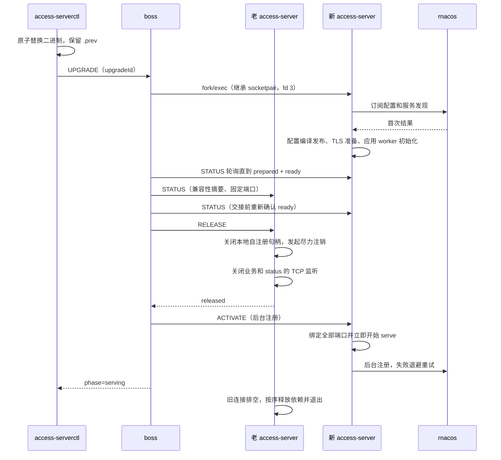

# Access Server 预热升级（boss 托管）

本文记录当前实现和运维边界。目标是把首次 Nacos 配置同步和应用 worker 初始化移到老进程仍在服务的阶段，缩短入口停止接流量的窗口。新进程仍需在老进程关闭 TCP 监听之后重新绑定端口，期间可能产生连接失败，不能据此宣称零停机或连接零损失。

## 1. 进程角色

| 进程                 | 职责                                                                                                                  |
| -------------------- | --------------------------------------------------------------------------------------------------------------------- |
| `access-server-boss` | 常驻、单线程的进程管理器。监听固定路径的控制 UDS，fork/exec access-server，跟踪各代角色，编排交接，崩溃后冷启动恢复。 |
| `access-server`      | 数据面。无 `--boss-fd` 参数时独立冷启动（行为与以往相同）；由 boss 拉起时通过继承的 socketpair 接受 boss 指令。       |
| `access-serverctl`   | 运维 CLI。只与 boss 通信：查询状态、替换二进制并通知升级、在释放监听前放弃升级。                                      |

boss 不连接 Nacos、不解析路由配置、不处理流量，也不绑定任何业务或 status 端口；端口始终由 access-server 自己绑定。boss 不托管时 access-server 不提供进程内升级能力，只支持普通冷启动。

## 2. 交接顺序



只有老进程明确回复 `released`，或 boss 通过 `waitpid` 确认老进程已经退出，boss 才会向新进程发送 ACTIVATE。发信号、连接断开或端口探测都不是释放确认。

Nacos 注册交替不作为监听切换的同步门槛。老进程只发起尽力注销，不等待远端成功确认；新进程开始接流量后再后台注册，失败以 100 ms 起步、最多 5 s 退避重试，不撤下已经就绪的监听。启用 HTTP/3 时，旧 UDP socket 保留到现有排空流程完成，新代通过 UDP `SO_REUSEPORT` 绑定同一端口。

普通冷启动（独立运行，或 boss 首次启动和崩溃恢复）保留原有顺序：准备 → 绑定 → 注册成功 → serve。只有升级激活采用准备 → 绑定 → serve → 后台注册。

## 3. 使用方式

构建三个程序：

```bash
cmake --build native/build --target fiber_app_access_server fiber_app_access_server_boss \
  fiber_app_access_serverctl --parallel
```

boss 参数：

```text
access-server-boss --socket=/run/access-server/boss.sock \
  --server=/opt/access-server/bin/access-server \
  --config=/etc/access-server/access-server.env \
  [--prewarm-timeout-millis=120000]
```

- `--socket`：控制 UDS 的绝对路径。所在目录必须属于 boss 的有效 UID，且不可被 group/other 写入；socket 文件权限为 `0600`。
- `--server`：access-server 二进制的绝对路径。必须是普通文件、可执行、不可被 group/other 写入。
- `--config`：传给 access-server 的 env 文件绝对路径。新代在启动时读取，修改后执行一次升级即可生效。
- `--prewarm-timeout-millis`：升级候选从启动到 ready 的总期限，1–3600000 ms，默认 120 s。

systemd 单元示例：

```ini
[Service]
User=access
RuntimeDirectory=access-server
RuntimeDirectoryMode=0700
ExecStart=/opt/access-server/bin/access-server-boss --socket=/run/access-server/boss.sock \
  --server=/opt/access-server/bin/access-server --config=/etc/access-server/access-server.env
AmbientCapabilities=CAP_NET_BIND_SERVICE
KillMode=mixed
TimeoutStopSec=120
Restart=on-failure
```

运维命令（`--socket` 指向 boss）：

```bash
access-serverctl status  --socket /run/access-server/boss.sock
access-serverctl upgrade --socket /run/access-server/boss.sock --binary /tmp/access-server-new
access-serverctl upgrade --socket /run/access-server/boss.sock   # 仅重新加载 env 文件
access-serverctl abort   --socket /run/access-server/boss.sock
```

`upgrade` 的执行顺序：

1. 查询 boss 状态。没有 serving 代、已有升级任务或仍有代在排空时直接拒绝，不修改任何文件。
2. 若给出 `--binary`：在目标目录写临时文件并 `fsync`，把当前目标硬链接为 `<server>.prev`，再 `rename(2)` 覆盖目标。目标路径在任何时刻都存在；运行中的进程继续使用旧 inode。
3. 发送 UPGRADE，并轮询到 `serving` 或 `failed`。等待期限为预热期限加 60 s。
4. 明确失败时，CLI 用 `<server>.prev` 恢复目标文件。结果未知（超时或 boss 不可达）时不恢复文件，提示先查询状态。

CLI 断开不会取消 boss 内的升级任务。`abort` 只能放弃尚未进入 releasing 阶段的升级；老进程一旦开始释放监听就不能撤销。

## 4. PREPARED 与 READY 的含义

新进程报告 `prepared` 时必须满足：

- 本地配置、入口策略及上游 TLS 信任等必要检查成功。
- 按现有规则完成项目列表、项目 route 的首次同步、编译和 batch 发布；NamingService selector lease 完成首次 readiness。
- 启用 TLS 时已有合法证书快照及有效配置回调，并保留 bootstrap identity 到 listener 完成加载。
- AccessServer 及应用 worker 初始化成功，包括 DNS resolver、连接池和 metrics 资源。

`ready=true` 另外要求灰度订阅有至少一次合法结果，test mode 的临时集群白名单也有至少一次合法结果，且 route 与 TLS readiness 仍为 Ready。NotFound/空结果依现有 codec 处理，未收到结果或传输错误不能当成空配置。冷启动只要求 `prepared`；升级候选要求 `prepared` 且 `ready`，并在 RELEASE 前由 boss 重新确认一次。

升级期间保持正常订阅与更新：同版本忽略、非法候选保留旧快照、合法删除与卸载沿用既有规则。不主动访问所有业务上游，不执行用户脚本探活，不为所有服务预建连接。

## 5. 状态

access-server 报告的 `state`：

| 状态       | 含义                                                           |
| ---------- | -------------------------------------------------------------- |
| preparing  | 本地资源和首次配置仍在准备                                     |
| prepared   | 已准备，尚未绑定业务/status 端口；`ready` 字段单独报告升级就绪 |
| activating | 正在绑定和开始 serve                                           |
| serving    | Server 已进入 Serving；后台注册可能仍为 pending/retrying       |
| draining   | TCP 监听已释放，已有请求/连接及 HTTP/3 UDP socket 仍可能存活   |
| stopping   | 进入后续依赖清理                                               |
| stopped    | Runtime 资源已释放                                             |

boss 升级任务的 `phase`：`idle`、`starting`、`preparing`、`checking`、`releasing`、`activating`、`serving`、`failed`。`releasing` 之前可以 abort。boss 状态同时报告 active、draining 和 candidate 各代的 PID 与状态、active 的注册状态、稳定错误码、二进制路径和预热期限，不返回配置正文或凭据。

## 6. 本地协议

协议版本 2，四字节网络字节序长度前缀加 JSON，单帧最大 8 KiB，读写各有完整帧 2 s 的 deadline。

**ctl ↔ boss**：固定路径 UDS，最多 16 个连接，每个连接最多 64 个请求。`SO_PEERCRED` 只接受与 boss 相同的有效 UID 或 root。

| 命令    | 行为                                                                                  |
| ------- | ------------------------------------------------------------------------------------- |
| STATUS  | 刷新 active 与 candidate 的状态后返回有界摘要                                         |
| UPGRADE | 需要 upgradeId；同一 ID 重试返回原任务状态，不同 ID 在任务未结束前返回 `UPGRADE_BUSY` |
| ABORT   | 放弃 `releasing` 之前的升级任务                                                       |

**boss ↔ access-server**：boss 在 fork 前创建 `SOCK_CLOEXEC` socketpair，子进程只继承自己那一端并放在 fd 3（`--boss-fd=3`）。连接无路径，不需要 peer 鉴权；access-server 校验 `SO_PEERCRED` 的 PID 等于 `getppid()`，并设置 `PR_SET_PDEATHSIG(SIGTERM)` 后再检查一次，防止 boss 已先退出。

| 命令     | 行为                                                                                |
| -------- | ----------------------------------------------------------------------------------- |
| STATUS   | 返回 state、ready、registration、兼容性摘要、固定端口与 HTTP/3 设置                 |
| ACTIVATE | 仅 prepared 时接受；`background` 区分升级（后台注册）与冷启动（前台注册）；异步执行 |
| RELEASE  | 仅 serving 时接受；本地注销、关闭 TCP 监听后回复 `released`，之后自动排空退出；幂等 |

boss 是这条通道上唯一的请求方，每个请求只有一个回复。任何读写错误、帧错误或超时都视为失联：boss 关闭该通道且不再复用失步的连接，子进程读到 EOF 后按 boss 崩溃同样处理，有界排空后退出。放弃候选使用 SIGTERM，而不是通道命令。

交接前比较业务/status 地址、TLS 与 test mode、入口、Nacos 环境及配置来源、注册地址策略等非敏感设置的摘要。配置本身不接受 port 0；boss 仍要求两代都报告固定端口，否则拒绝升级。允许任一代或两代开启 HTTP/3。

## 7. 故障处理

| 情况                                        | 行为                                                                                    |
| ------------------------------------------- | --------------------------------------------------------------------------------------- |
| 预热失败、超时、候选退出、配置不兼容、abort | 不释放旧监听；ABORT 候选；CLI 恢复 `.prev`                                              |
| 仍有代在排空                                | 拒绝新的升级（`PREVIOUS_PROCESS_DRAINING`），避免代际资源叠加                           |
| 老进程明确拒绝 RELEASE                      | 老进程继续服务，候选被 ABORT（`RELEASE_FAILED`）                                        |
| RELEASE 应答丢失                            | boss 关闭与老进程的通道，使其有界退出；确认退出后才激活候选，否则 `RELEASE_UNCONFIRMED` |
| 释放后激活失败                              | 任务失败（`ACTIVATION_FAILED`）；boss 立即用 known-good 二进制冷启动恢复                |
| 升级期间 active 意外退出                    | 不另行冷启动；候选就绪后跳过 RELEASE 直接激活；任务失败则冷启动恢复                     |
| serving 代崩溃                              | 用 known-good 二进制冷启动；首次立即重启，连续失败按 1 s 起步、最多 30 s 退避           |
| 注册暂时失败                                | 新代继续接流量，记录固定事件并退避重试                                                  |
| 多端口绑定部分失败                          | 清理新代已经绑定的监听和资源，按激活失败处理                                            |
| 旧连接长期不结束                            | 保持 draining，不自动强杀，并拒绝后续升级                                               |
| boss 收到 SIGTERM/SIGINT                    | 放弃升级任务，向所有子进程发送 SIGTERM，等待全部正常排空退出后退出                      |
| boss 崩溃                                   | 子进程读到通道 EOF（或收到 PDEATHSIG），有界排空 5 s 后退出                             |

**known-good 二进制**：boss 每次拉起子进程前打开二进制并持有 fd，用 `fexecve` 执行这个 inode。某一代进入 serving 后，boss 把它的二进制记为 known-good；崩溃恢复和激活失败恢复都执行 known-good inode，不受磁盘文件后续被替换的影响。boss 自身重启（冷启动）时读取磁盘上的当前文件。

**boss 崩溃即停服**：子进程不会在没有 boss 的情况下继续服务，也不会被重新认领。systemd 下 boss 退出后，剩余子进程同样受 `TimeoutStopSec` 约束；5 s 的有界排空缩短了恢复前的等待。容器中 boss 作为 PID 1 时，内核会在其退出后直接终止同命名空间的全部进程。boss 自身升级等同于一次实例冷重启。

## 8. 日志目录

两代可以使用相同的 `ACCESS_SERVER_ACCESS_LOG_DIR`。Fiber `FileAppender` 以 `O_APPEND` 打开文件、整块写入；轮转先以 `O_EXCL` 新建空归档再用 `RENAME_EXCHANGE` 原子互换，因此两个进程不会覆盖彼此的文件，归档序号冲突会自动递增，本地文件系统上单行不会交错。接受以下剩余行为：

- 新代轮转后，老代的 fd 仍指向被换成归档名的文件，排空期的尾部日志写入该归档而不是 `access.log`。采集器需要按 inode 跟踪改名文件足够久（例如 Fluent Bit tail 默认 `Rotate_Wait 5` 秒后不再读取改名文件）。
- 两代各自计数，重叠期 `access.log` 可能超过 100 MiB；若两代都触发轮转，会互相把对方的活跃文件换成归档名，不丢数据但文件内容混杂。老代释放后只写在途请求，实际很少触发。
- 归档保留按进程各自的视图计算，重叠期总数可能短暂超过 300；两代日志按 flush 块交错，文件内时间戳不严格单调。
- 必须使用本地文件系统（NFS 上 `O_APPEND` 不原子），且保持 `truncate_incomplete_tail` 关闭。

## 9. 部署注意

- **特权端口**：boss 不绑定端口。推荐 systemd `AmbientCapabilities=CAP_NET_BIND_SERVICE`，boss 与 exec 出的子进程都继承。不要对 access-server 使用 `setcap`：替换文件会丢失 file capability，而且 file capability 会清除 PDEATHSIG 并进入 secure-exec 模式。也可以设置 `net.ipv4.ip_unprivileged_port_start`（全机生效）。
- **二进制权限**：二进制及其目录不应允许服务用户写入，否则被攻破的数据面可以植入下次被 boss 执行的程序。通常由 root 执行 `access-serverctl upgrade`，boss 的 peer 校验因此同时放行 root。
- **容器**：二进制在镜像中，容器内替换会在容器重建时丢失并与镜像 tag 不一致。容器部署要么把二进制放在卷上，要么把容器内升级视为临时手段。当前 Compose 演示仍以独立模式运行 access-server。
- **容量**：部署需要预留约两代线程、内存和 FD 的峰值容量。
- **首次迁移**：从独立运行或已删除的 `--control-dir` 模式迁移到 boss 需要一次常规冷重启。

Console 的 draft、published、实例配置激活证据保持独立。进程 ready/serving 或 Nacos 注册成功都不是 Release 全量激活证明；原有类型化证据合同不变。

## 10. 验证与测量

针对性单元测试覆盖：协议编解码、分片与上限；参数解析；子进程通道的 STATUS/ACTIVATE/RELEASE/ABORT 规则、boss EOF 与本地关闭的区别；boss 状态机（冷启动、升级、RELEASE 先于 ACTIVATE、预热超时、不兼容、候选退出、abort、第三代拒绝、释放后激活失败的 known-good 恢复、升级期间 active 崩溃、崩溃退避、停止）；真实 fork/exec 的 fd 3 继承与 CLOEXEC；二进制原子替换与恢复；控制 socket 的目录权限、遗留 socket 与 peer 校验。

显式双进程集成测试启动可丢弃的本地 rnacos、gRPC 延迟代理和确定性上游：

```bash
python3 native/access-server/scripts/run_prewarm_upgrade.py \
  --server native/build/apps/access-server \
  --boss native/build/apps/access-server-boss \
  --ctl native/build/apps/access-serverctl \
  --rnacos /path/to/local/rnacos \
  --tls
```

脚本把 access-server 复制到私有临时目录作为 boss 的 `--server`，验证：阻止新代首次 Nacos 结果时旧代持续服务；`upgrade --binary` 替换文件并保留 `.prev`；旧代长请求完成后正常退出；新代注册恢复；预热中 abort 后 active 不受影响并恢复 `.prev`；SIGKILL active 后 boss 冷启动恢复；SIGTERM boss 后全部子进程正常退出；SIGKILL boss 后子进程有界退出。`--tls` 额外需要 openssl 和支持 HTTP/2 的 curl；`--http3 --workers 1|2` 在交接期间保留另一个只设置 `SO_REUSEPORT` 的同端口 UDP socket。升级后后台注册不阻挡 serve 由单元测试覆盖，集成脚本不再暂停 rnacos。

脚本输出 CLI 命令总时间和入口探测结果。命令耗时包含预热和轮询，不能称为精确 listener 空窗；离散探测未观察到失败，也不能证明不存在更短的失败窗口。生产脚本差分和最终切流门槛继续由原有兼容文档管理，不因该功能通过本地测试就宣称整体生产兼容完成。

## 11. 相关实现

- [boss 状态机](../native/access-server/src/runtime/AccessBoss.cpp)
- [子进程拉起与二进制固定](../native/access-server/src/runtime/AccessBossLauncher.cpp)
- [access-server 侧 boss 通道](../native/access-server/src/runtime/AccessBossChannel.cpp)
- [控制协议](../native/access-server/src/runtime/AccessControlProtocol.cpp)
- [二进制替换](../native/access-server/src/runtime/AccessServerBinaryInstall.cpp)
- [控制 CLI](../native/access-server/src/control_main.cpp)
- [boss 入口](../native/access-server/src/boss_main.cpp)
- [Runtime 协调](../native/access-server/src/runtime/AccessRuntimeCoordinator.cpp)
- [后台注册](../native/access-server/src/runtime/AccessControlPlaneSupervisor.cpp)
- [激活证据边界](activation-evidence.md)
