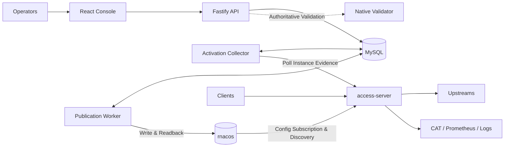
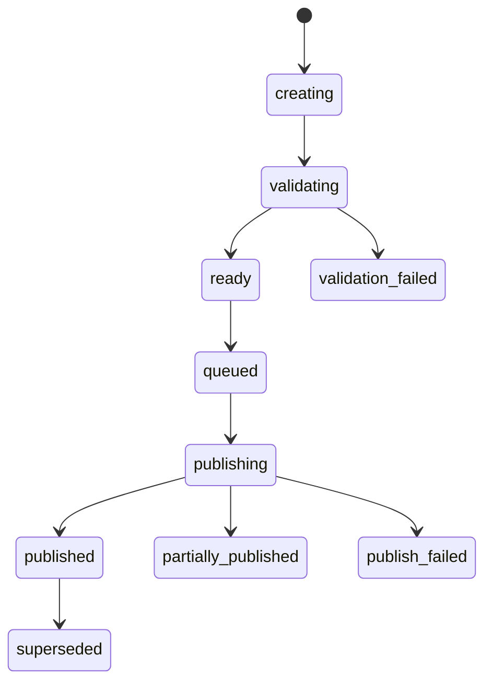
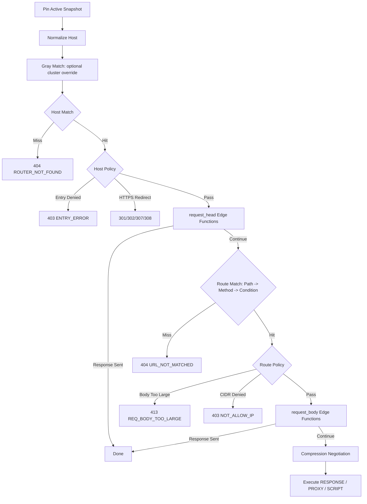

# Fibron Architecture and Principles

This document explains why Fibron _(formerly Access Gateway)_ is layered the way it is, how
configuration travels from the Console to data-plane instances, and how a request moves through
`access-server`. For the feature inventory see [README](../README.md); for field-level syntax see
the [user guide](user-guide/README.md).

## 1. Components and Boundaries

| Component            | Owns                                                                                    | Explicitly Does Not Do                                     |
| -------------------- | --------------------------------------------------------------------------------------- | ---------------------------------------------------------- |
| `access-server`      | Only process on the traffic path: Project/route selection, policy enforcement, proxying | Never reads Console DB; has zero WAF-specific logic        |
| Console API          | Authoring, validation, encrypted versions, Release orchestration, RBAC, and audit       | Never proxies gateway traffic or touches data-plane memory |
| Publication Worker   | Leased task claims; writes and reads back each rnacos Data ID                           | Never declares an instance active                          |
| Activation Collector | Polls typed evidence from each instance and aggregates onto Releases                    | Never infers activation from readback, liveness, or logs   |
| Native Validator     | Offline stdin/stdout binary reusing the exact data-plane codec and compiler             | Never opens network connections                            |
| rnacos               | Configuration transport and NamingService discovery                                     | Not a transactional store across multiple Data IDs         |
| MySQL                | Control-plane persistence: versions, Releases, certificates, audit, evidence            | Never read by the data plane                               |

Three design rules govern the entire system:

1. **Strict contract boundary.** Runtime configuration crosses solely through the rnacos wire
   contract; operational status crosses through explicit, authenticated, bounded APIs.
2. **The native codec is the single source of truth.** Accepted fields, defaults, scalar coercion,
   semantic validation, and resource limits live in `native/access-server`. The Console invokes the
   compiled Native Validator binary instead of re-implementing validation logic in TypeScript.
3. **Never present unproven state as fact.** Missing or expired activation evidence is reported as
   `unknown`, never inferred as `active`.

Reusable runtime primitives (EventLoop, HTTP/1.1/2/3, Nacos client, CAT, Prometheus, JSON, script
engine) come from the pinned `third_party/fiber-gateway-cpp` submodule; gateway product policy and
wire compatibility belong in `native/access-server/`.

## 2. Three Distinct Lifecycle States

Every configuration passes through three independent states:

| State     | Meaning                                                 | Evidence Source                                   |
| --------- | ------------------------------------------------------- | ------------------------------------------------- |
| Draft     | Immutable encrypted configuration version in Console    | MySQL                                             |
| Published | Written to rnacos and verified by digest readback       | Per-resource write/readback records from Worker   |
| Active    | Confirmed present in an instance's live active snapshot | Fresh typed evidence polled from `/v1/activation` |

A successful rnacos write proves nothing about live traffic: an instance might not have received the
notification yet, might have rejected an invalid candidate, or might be unreachable. Keeping these
states distinct prevents operators from mistaking a config-store write for a verified rollout.

## 3. Control Plane: Draft to rnacos

### 3.1 Three-Stage Validation

1. **Field syntax:** Browser and Fastify schemas check types, lengths, and enums immediately.
2. **Cross-resource relationships:** Host collisions, Project policy vs Route field conflicts, and
   certificate references.
3. **Full-environment native compilation:** Compiled wire payloads are piped through
   `access-gateway-validator` running the real C++ codec and compiler.

Creating a Release fails closed if the Native Validator is unavailable. At startup, the Console runs
`access-gateway-validator --describe-config-limits` so UI, API, and data plane share identical
versioned resource limits.

### 3.2 Deterministic Compilation

The Console's authoring model compiles deterministically into native wire payloads:

- YAML routes compile to wire JSON; JavaScript routes compile to `type: SCRIPT`.
- Project HTTPS redirects compile into per-Host policy; Project CIDR policies inject into each
  route.
- WAF rule groups compile into standard edge-function scripts (see [Section 9](#9-edge-functions-and-waf)).

Identical inputs always produce identical bytes, enabling content-digest readback checks, unchanged
script write skipping, and data-plane compile caching.

### 3.3 Immutable Releases and Drift-Safe Publication

Releases are persisted immutably before publication with target payloads and baseline rnacos
digests. Rollback creates a new Release from historical content rather than rewriting history.

Because rnacos lacks multi-key transactions, the leased Publication Worker processes each resource
in dependency order (`publishOrder`), checks for out-of-band drift against the baseline digest
(stopping with `conflict` instead of clobbering manual edits), writes, and reads back to verify:

- New Project: write route Data ID first, then update Project list.
- Edge functions: write and verify all scripts first, then update the index.
- Upstream mTLS client certificates: publish TLS Release first, then Routes referencing the UUID.

## 4. Data Plane: Config Ingestion and Snapshots

### 4.1 Single Nacos Owner Loop

`access-server` separates four EventLoop roles: accept loop, HTTP worker group, Nacos owner loop,
and CAT sender loop. All config watchers, subscriptions, route stores, certificate stores, and
discovery leases live exclusively on the Nacos owner loop, where candidates are decoded, validated,
and compiled inline—structurally eliminating shared-lock contention on config ingestion.

### 4.2 Immutable Snapshots and Request Pinning

Every compiled snapshot pre-builds Host tries, Path matchers, bytecode expressions/templates,
compiled scripts, CIDR matchers, and precompressed static bodies before publication. Each incoming
request pins the current snapshot pointer at start and releases it on completion, so requests never
observe partial updates and never acquire config locks on the hot path.

### 4.3 Failure-Retains-Old-Snapshot Semantics

| Candidate Input                                 | Runtime Behavior                                       |
| ----------------------------------------------- | ------------------------------------------------------ |
| New version, valid & within limits              | Compile and atomically swap active snapshot            |
| Identical version                               | Ignore                                                 |
| Invalid or exceeds resource limits              | Reject, retain previous snapshot, record evidence      |
| Removed from Project list / empty Host bindings | Unload Project cleanly                                 |
| Any edge-function script missing or invalid     | Retain entire previous edge-function snapshot (atomic) |

Cold startup is fail-closed: initial Project list, referenced routes, and TLS certificates (when TLS
is enabled) must be valid before binding listeners and registering in Nacos.

### 4.4 Compile-Time Publication Ordering

Project updates use move-only C++ typestates:
`CompiledProjectConfig` → `PreparedProjectUpdate` → `ReadyProjectUpdate` → `commit()`. Because
`commit()` accepts only `ReadyProjectUpdate`, publishing a route before its service discovery state
is ready is prevented at compile time.

## 5. Request Pipeline

Key ordering choices:

- **Network boundary before scripts:** entry-network checks and HTTPS redirects run before any edge
  function.
- **`request_head` before route matching:** protects unmatched scanner paths too.
- **On-demand body buffering:** bodies stream directly unless a mounted `request_body` function
  explicitly opts in on a `PROXY` route (capped at 1 MiB).

## 6. Routing and Upstream Selection

- **Host & Path matching:** HTTP `Host` / `:authority` selects the Project (independent of TLS SNI).
  Within a Project, static segments beat parameters (`:id`), which beat tail wildcards (`*rest`).
  Candidates on the same path node evaluate `method` and compiled `condition` in configured order.
- **Worker-sharded SWRR:** Each HTTP worker maintains its own Smooth Weighted Round Robin shard to
  eliminate cross-thread mutex contention, while per-endpoint circuit-breaker state
  (`AccessUpstreamCircuit`) is shared across workers with bounded atomic reads on the healthy path.
- **Connections & retries:** Per-worker bounded DNS resolver (no implicit public fallback), Happy
  Eyeballs under one connect deadline, HTTP/1.1 upstream pooling, and up to 4 retries strictly
  before sending the request head.
- **Upstream TLS isolation:** Each `upstream_tls` profile carries a pool affinity generation so
  updated TLS settings never reuse stale upstream connections.

## 7. TLS Certificate Management

Certificates are stored encrypted in MySQL and published atomically as a complete snapshot.
`access-server` builds exact and single-label wildcard SNI indexes directly from each leaf
certificate's DNS SANs—eliminating manual domain-to-certificate bindings. `ClientHello` selection is
lock-free and zero-allocation. Upstream mTLS client certificates are referenced by immutable version
UUID so private keys never appear in route JSON.

## 8. Edge Functions and WAF

The data plane has **no WAF-specific logic**. Instead, it runs sandboxed compiled edge functions
mounted on Projects; the Console compiles WAF rule groups into ordinary edge-function scripts
(`waf-<group>`).

- **Zero overhead for unmounted Projects:** globs expand at snapshot compile time into a flat index.
- **Sticky sampling & mutex canary (`replaces`):** CRC-32 of the resolved client IP determines
  sampling buckets. A canary function claiming `replaces` narrows the incumbent's bucket range so
  every request executes exactly one version; removing the canary cleanly restores the old function.
- **Compile-time safety:** read-only request view, no upstream calls, no `while` loops or recursion,
  RE2 regex engine (no catastrophic backtracking), and fail-open default
  (`ACCESS_SERVER_EDGE_FUNCTION_FAIL_CLOSE=true` for 503).

## 9. Instance Activation Evidence

Each `access-server` exposes an optional Bearer-authenticated `/v1/activation-evidence` endpoint on
the status listener, publishing atomic snapshots of active/observed digests without touching the
request path. The leased Activation Collector polls configured targets with bounded TTLs and
aggregates results onto each Release with precedence `degraded` > `unknown` > `pending` > `active`.

## 10. Process Lifecycle and Prewarmed Upgrades

- **Startup:** load config → wait for valid initial snapshot → bind listeners → register in Nacos →
  accept traffic.
- **Shutdown:** deregister first → drain metrics and traffic listeners → tear down pools, DNS, CAT,
  subscriptions, and Nacos client in reverse dependency order.
- **Prewarmed upgrades:** `access-server-boss` spawns the new generation to sync config and warm
  workers while the old generation still serves, then hands off TCP listeners. This minimizes the
  handover window (though it is not strictly zero-downtime, and overlapping HTTP/3 UDP traffic can
  drop during handover). See [prewarm upgrade design](access-server-prewarm-upgrade-design.md).

## 11. Trust Boundaries and Observability

- **Unified `ClientMetadata`:** resolved once per request (`direct`, `trusted_proxy`, or
  `legacy_headers`) and reused consistently by HTTPS redirect, CIDR allow/deny, gray match, and
  logging. `X-Entry` is server-synthesized from mandatory `ACCESS_SERVER_NETWORK_ENTRY`.
- **Bounded metrics & non-blocking logs:** Prometheus labels use compile-time enums plus LRU-capped
  dynamic families ([bounded metrics](../native/access-server/docs/bounded-metrics.md)). Async logs
  drop on queue full rather than exerting backpressure on request workers.

## Further Reading

- [Chinese Architecture Document](architecture.md)
- [Performance Benchmarks](benchmarks.en.md) |
  [Full Benchmark Baselines (ZH)](../native/access-server/docs/benchmark-baselines.md)
- [Edge Functions & WAF Design](edge-functions-and-waf-design.md)
- [Instance Activation Evidence](activation-evidence.md)
- [Network Policy & Certificate Design](network-policy-and-certificate-design.md)
- [Compatibility Contract](../native/access-server/docs/compatibility-contract.md)
