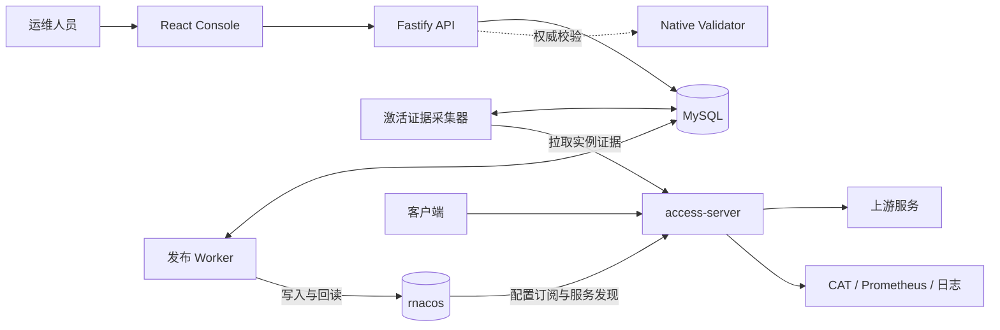
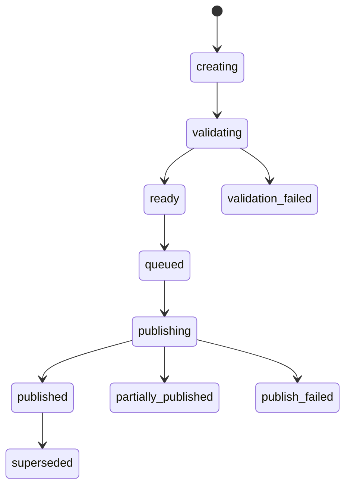
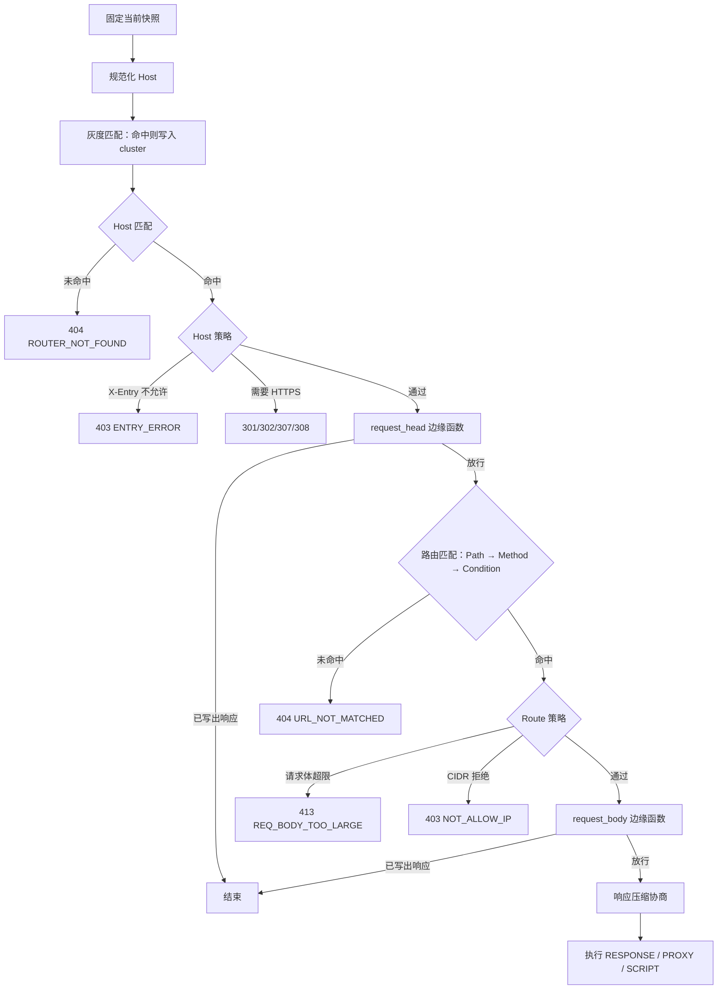

# Access Gateway 架构与原理

本文解释 Access Gateway 为什么这样分层、配置如何从控制台到达实例，以及一个请求在数据面如何被处理。功能清单见 [README](../README.zh-CN.md)，字段和用法见[用户指南](user-guide/README.md)，各专题的完整设计见文末的[延伸阅读](#15-延伸阅读)。

## 1. 组件与边界

| 组件             | 职责                                                               | 明确不做                          |
| ---------------- | ------------------------------------------------------------------ | --------------------------------- |
| access-server    | 唯一处于流量路径上的进程：选择项目和路由、执行策略、响应或代理请求 | 不读控制台数据库，不理解 WAF 语义 |
| Console API      | 配置编辑、校验、版本、Release 编排、权限和审计                     | 不转发网关流量，不访问数据面内存  |
| 发布 Worker      | 按租约领取发布任务，逐资源写入并回读 rnacos                        | 不判定实例是否已生效              |
| 激活证据采集器   | 向每个实例拉取类型化证据并聚合到 Release                           | 不从回读、进程存活或流量推断生效  |
| Native Validator | 离线 stdin/stdout 进程，复用数据面的 codec 和编译器                | 不连接 Nacos 或任何网络           |
| rnacos           | 配置载体和服务发现                                                 | 不是事务系统，不保证多资源原子性  |
| MySQL            | 控制面的持久化：版本、Release、证书、审计、证据                    | 数据面不访问                      |

三条规则贯穿整个设计：

1. **控制面和数据面只通过契约交互。** 运行时配置只经过 rnacos wire 契约，运行状态只经过有鉴权、有上限的显式 API。两边都不能绕过这个边界直接读对方的存储或内存。
2. **Native codec 是唯一权威。** 字段、默认值、标量转型、语义校验和失败处理都以 `native/access-server` 为准。控制台模型可以更丰富，但必须确定性地编译成 native wire 格式，校验时也调用同一份 native 代码，而不是在 TypeScript 里再实现一遍。
3. **不把未证明的事情说成事实。** 缺少证据时显示“未知”，不显示“成功”。

数据面的通用能力（EventLoop、HTTP、Nacos 客户端、CAT、Prometheus、JSON、脚本引擎）来自固定版本的 `third_party/fiber-gateway-cpp` 子模块；网关产品策略和 Java 兼容行为留在本仓库。

## 2. 三种状态

一份配置的生命周期被拆成三个彼此独立的事实：

| 状态      | 含义                               | 证据来源                          |
| --------- | ---------------------------------- | --------------------------------- |
| Draft     | 已保存到控制台的不可变配置版本     | MySQL                             |
| Published | 内容已写入 rnacos，且回读摘要一致  | 发布 Worker 的逐资源写入/回读记录 |
| Active    | 某个实例的活动快照确实包含这份内容 | 该实例上报的类型化证据            |

拆开的原因是 rnacos 写入成功什么也证明不了：实例可能尚未收到通知，可能因校验失败拒绝了候选，也可能根本不在线。如果把 Published 渲染成 Active，运维人员会在配置实际未生效时误判发布已完成。

## 3. 控制面：从草稿到 rnacos

### 3.1 分层校验

配置按三层校验，越靠后越权威：

1. **字段语法**：浏览器和 API schema 检查类型、长度和枚举，尽早给出反馈。
2. **跨资源关系**：检查 Host 冲突、Project 级策略与 Route 字段的冲突、证书引用等。
3. **全环境校验**：把编译产物交给 Native Validator，走真实的 codec 和编译器。

Release 准备阶段要求 Validator 和限额探测可用，否则 fail closed。Console 启动时运行 `access-gateway-validator --describe-config-limits` 读取版本化的资源限额，这样浏览器、API 和数据面使用同一组数字。

### 3.2 确定性编译

控制台的编辑模型和 wire 格式是分开的，发布时单向、确定性地编译：

- YAML Route 编译为 wire JSON；JavaScript Route 编译为 `type: SCRIPT`。
- Project 的 HTTPS redirect 编译为每个 Host 的策略；Project 级 CIDR 策略注入每条 Route。
- WAF 规则组编译为边缘函数脚本（见[第 9 节](#9-边缘函数与-waf)）。

相同输入总是产生相同字节，所以内容摘要可以用作身份：回读比对、未变脚本跳过写入、数据面编译缓存都依赖这一点。

### 3.3 Release

Release 是不可变的发布单元。它在发布之前先落库，包含每个资源的目标内容和创建时读到的 rnacos 基线摘要，这样无论发布走到哪一步，历史记录都能说清楚“本来打算写什么”。

回滚不改写历史，而是从历史内容创建一个新的 Release。`partially_published` 和 `publish_failed` 是终态，恢复方式同样是创建新的 Release。

### 3.4 发布 Worker

rnacos 没有多资源事务，所以发布被设计成一个可观察的逐资源流程。Worker 通过数据库租约领取任务并持续心跳，多副本之间不会重复执行。每个资源按 `publishOrder` 处理：

1. 确认依赖的资源已经 `verified`。
2. 读取 rnacos 当前值，与目标和基线比较：

   | 当前值       | 决策                                                        |
   | ------------ | ----------------------------------------------------------- |
   | 已等于目标   | 不写，只验证                                                |
   | 等于基线     | 写入或删除                                                  |
   | 两者都不等于 | 冲突，标记 `conflict` 或 `conflict_after_partial`，停止写入 |

3. 写入后回读并比对摘要，记录这次尝试。

第二步的基线比较是漂移检测：如果有人绕过控制台改了 rnacos，发布会停下来，而不是静默覆盖。

顺序约束靠依赖边保证，让数据面在任何中间状态都不会看到指向不存在内容的索引：

- 新 Project：先写 route，再写 Project List。
- 边缘函数：先写全部脚本并回读成功，最后写索引。
- 客户端证书：先发布包含新证书版本的 TLS Release，再发布引用它的 Route。

### 3.5 rnacos 资源模型

rnacos 上的资源沿用“索引 + 每条目独立 Data ID”的模式，这让单个项目或函数的更新不必重写全部内容：

| 用途                    | Data ID                                     | Group           | 形态         |
| ----------------------- | ------------------------------------------- | --------------- | ------------ |
| Project 列表            | `ploto.unified-access.projects`             | `ACCESS-SERVER` | 分号分隔文本 |
| Project 路由            | `ploto.unified-access.route.<project>`      | `ACCESS-SERVER` | JSON         |
| TLS 证书快照            | `ploto.unified-access.tls-certificates`     | `ACCESS-SERVER` | JSON         |
| 边缘函数索引            | `ploto.unified-access.edge-functions`       | `ACCESS-SERVER` | JSON         |
| 边缘函数脚本            | `ploto.unified-access.edge-function.<name>` | `ACCESS-SERVER` | 纯文本脚本   |
| 灰度规则                | `ploto.unified-access.gray-match`           | `DEFAULT_GROUP` | JSON         |
| 测试环境 cluster 白名单 | `ploto.test.temp-cluster-apps`              | `DEFAULT_GROUP` | JSON         |

Project 列表和路由保持与 Java `ploto-unified-access` 相同的 wire 行为。边缘函数是全新能力，没有 Java 包袱，使用严格 JSON，未知字段一律拒绝。

## 4. 数据面：接收配置

### 4.1 单一 owner loop

进程内有四类 EventLoop：accept loop、HTTP worker group、Nacos owner loop 和 CAT sender loop。所有配置状态（watcher、订阅、版本、路由存储、证书存储、服务发现租约）都归 Nacos owner loop 所有，候选配置在这个 loop 上内联解码、校验和编译。

这样做不需要编译线程、跨 loop 任务协议和共享锁，配置路径上的并发问题被结构性地消除了。生产实例的实测表明，配置编译的频率和耗时都足够低，内联不会影响配置通知的处理。

### 4.2 不可变快照与请求固定

配置的产物是不可变的 compiled snapshot。Host 树、Path matcher、模板、脚本字节码、CIDR 和地址计划、预压缩的静态响应，全部在发布快照之前准备好。

请求开始时固定（pin）当前快照的引用，之后全程使用它。新快照原子替换后，已开始的请求继续使用旧快照直到结束，旧快照在最后一个引用释放时回收。因此一个请求不可能看到一半新、一半旧的配置，请求路径上也不需要为读取配置加锁。

### 4.3 失败保旧

运行期收到候选配置时，结果只有以下几种：

| 输入                           | 行为                     |
| ------------------------------ | ------------------------ |
| 新版本且完整有效               | 编译后原子发布           |
| 版本与当前相同                 | 忽略                     |
| 非法或超出资源限额             | 保留旧快照，记录拒绝证据 |
| 从 Project 列表移除、Host 为空 | 卸载该项目               |
| 边缘函数任一脚本缺失或编译失败 | 全部保留旧快照（全或无） |

“移除”和“失败”是两件事：前者是明确的意图，后者绝不能让线上路由消失。

首次启动时规则相反：Project 列表和每个被引用的 route 必须存在且有效，TLS 开启时证书快照也必须有效，否则进程 fail closed，不会用不完整的配置开始服务。

### 4.4 用类型系统保证发布顺序

Project 候选的发布用 move-only 类型表达状态：`CompiledProjectConfig` → `PreparedProjectUpdate` → `ReadyProjectUpdate` → `commit()`。`commit()` 只接受 `ReadyProjectUpdate`，所以“服务发现尚未就绪就发布路由”这类错误在编译期就被排除。

所有配置资源都有版本化的上限（payload 字节数、路由数、Host 数、脚本大小、快照内存估算等）。上限在解析前和编译期强制执行，是产品的安全不变量而不是部署调优参数。

## 5. 请求流水线

顺序背后的取舍：

- **网络边界先于应用逻辑。** 入口和 HTTPS 判定在任何脚本之前完成，边缘函数出错不会影响这些判定。
- **边缘函数在路由之前。** 扫描器常打不存在的路径，放在路由之前才能保护这些路径。未命中 Host 的请求无法定位到项目，直接返回 404，不进入函数。
- **请求体只在必要时读取。** 只有 `request_body` 函数、且路由显式选择开启时才缓冲请求体，其余情况请求体直接流式转发。

## 6. 路由匹配

Project 由 HTTP `Host` 或 `:authority` 选择，而不是 TLS SNI，两者各自独立。全部项目的 Host 模式合并成一棵全局 Host 树，模式规范化后在项目之间不能重复。

每个 Project 内的 Route 按 Path 结构组织成 matcher：静态段优先于参数段（`:id`），参数段优先于尾部通配段（`*rest`）。同一个 matcher 节点上可以有多个候选，它们按配置顺序依次判断 `method` 和 `condition`，所以“顺序优先”只在同一节点内成立。

`condition` 和模板 `${...}` 表达式在配置阶段编译成字节码，请求时同步执行不可变程序。method 不匹配不会返回 405：所有候选都失败时统一返回 404，这是 Java 兼容行为。

## 7. 上游选择与连接

PROXY Route 的上游来自 NamingService（`service`）或静态地址（`addresses`），配置了 `service` 时静态地址不作为回退。

**cluster 决策。** 灰度命中的 cluster 优先，其次是请求上下文指定的 cluster，最后是 Route 默认 cluster。请求指定的 cluster 选择失败时回退到配置 cluster，回退条件在生产和测试模式下不同（见[兼容契约](../native/access-server/docs/compatibility-contract.md)）。

**实例选择。** 服务目录是不可变视图，只包含 enabled、healthy 且权重为正的实例，按 cluster 过滤并优先选择本 zone。每个 worker 持有自己的平滑加权轮询（SWRR）分片，避免跨线程竞争；失败状态按 endpoint 在 worker 之间共享（`AccessUpstreamCircuit`），健康路径上只读原子变量。请求固定所选实例的 discovery generation，保证实例列表刷新时不影响进行中的请求。

**连接建立。** hostname 通过 per-worker DNS resolver 解析，resolver 配置在 EventLoop 启动前固定，没有隐式的公共 DNS 回退。多地址时用 Happy Eyeballs 在单一总期限内交错尝试，一次逻辑连接只占用一个连接池 lease。上游协议是 HTTP/1.1。

**重试边界。** 只有在请求头尚未开始发送时才重新选择实例，最多尝试 4 次。一旦开始发送就不再重试，避免重复提交非幂等请求。

**TLS 隔离。** 每个 `upstream_tls` profile 都有独立的连接池 affinity，`generation` 递增后新旧配置不会复用同一条连接，已固定旧快照的请求可以安全完成。

## 8. TLS

证书在控制台以加密形式存储，通过 TLS Release 作为一份完整快照发布到 rnacos。数据面从 leaf 证书的 DNS SAN 编译出 exact 和单层 wildcard 索引，候选完整校验后原子切换。ClientHello 选证书的热路径不加锁、不分配内存。

SNI 选择器完全由证书内容派生，不存在第二份人工绑定，所以证书和它覆盖的域名不会失去同步。证书续期只要 SAN 不变就直接切换；增减 SAN 会改变 SNI 覆盖范围，控制台要求显式确认。

证书快照的订阅在明文监听模式下也会运行，因为 Route 可以用不可变的证书版本 UUID 作为上游 mTLS 客户端身份。Route JSON 里只有这个引用，私钥只存在于加密的 TLS 快照资源中。引用在实例当前快照中不存在时，只拒绝该 Route 候选并保留旧快照。

## 9. 边缘函数与 WAF

### 9.1 分层决策

数据面不理解 WAF。它只提供通用的“边缘函数”钩子：挂载在一组项目上、用 Fiber 脚本写的函数。WAF 是控制面的第一个编译目标，规则在发布前被生成为普通的边缘函数脚本。

如果让数据面理解 WAF，规则的 severity、scope、action、豁免等语义都要进入 codec、limits、validator 和 watcher，规则模型的每次演化都成了跨组件变更。把策略留在控制面后，“规则组 × 项目模式”这类组合在发布期完成，数据面保持零策略，将来的限流、请求改写也可以复用同一个钩子。

### 9.2 编译

每个 mode 非 `off` 且含规则的组编译为一个函数 `waf-<组 id>`，组的 include 和 exempt 直接成为挂载选择器。项目级模式也在发布期折叠：`off` 的项目进入 exclude，零执行成本；`log` 和 `block` 的项目共享同一份脚本，脚本内按项目判定。

生成的脚本是 priority 升序的 if 链。`scope.methods` 和 `scope.paths` 折叠成前置判断，`scope.sourceCidrs` 去重后成为脚本顶部的 `cidr` directive。规则中的字面量经过专门的转义器进入脚本字符串，这是安全关键点：转义错误等于规则语义偏移。转义器有单元测试和黄金 fixture，生成产物还必须通过 Native Validator 编译。

### 9.3 执行

- 函数按挂载 `priority` 升序执行，共享请求已有的脚本堆，没有额外分配。
- 函数发送了响应就结束请求，后续函数和路由都不再执行。
- 未挂载函数的项目零成本：快照内的联合索引在配置期展开 glob，请求期只查一次表。
- 采样是粘性的：对端 IP 的 CRC-32 决定抽签值，同一客户端的行为保持一致，比例上调时原命中者继续命中。
- 函数异常默认 fail-open（放行并计数），因为 WAF 故障不应打死网关。可以用 `ACCESS_SERVER_EDGE_FUNCTION_FAIL_CLOSE=true` 改为 503，但配置组装失败依然只是保留旧快照。

函数的权限被编译期收紧：只读请求、不可发起上游调用、不可改写请求，未注册的函数名直接编译失败。脚本方言没有 `while`、递归和用户函数，唯一的循环是遍历有限容器；`strings.match` 基于 RE2，没有回溯炸弹。VM 本身没有指令预算，这些静态限制是当前的主要防线。

### 9.4 请求体阶段

`request_body` 函数读取缓冲后的 `$req.body`。条件依次是：项目挂载了 body 阶段函数、路由是 PROXY 且开启 `edge_function_body`、content-type 在固定白名单内、声明长度未超上限。流式读取超限时保留已缓冲前缀、跳过函数，前缀和未读尾部继续拼接发往上游，所以缓冲对无上限的上传也是有界的。

## 10. 激活证据

数据面在 status listener 上提供 `/v1/activation-evidence`，默认关闭，开启后要求 Bearer token。证据包含实例身份、构建版本、Project 列表、各 Project、灰度、TLS 的已观察与活动摘要，以及快照 generation。配置内容和自由文本错误不出站。

watcher 把完整证据快照通过原子指针发布，读取方只固定快照，所以证据查询不影响请求路径。Project 明细分页，游标绑定 evidence revision，遍历中途变化时返回 409 并整体重试，避免拼出不一致的视图。

采集器以独立进程运行，用数据库租约保证多副本安全，每条观察都有 TTL。逐实例结果聚合到 Release：

| 状态       | 含义                                           |
| ---------- | ---------------------------------------------- |
| `active`   | 所有必需实例的证据新鲜，且精确匹配全部资源     |
| `pending`  | 证据新鲜，但目标尚未进入活动快照               |
| `degraded` | 采集失败、鉴权失败、候选被拒绝或缺少目标元数据 |
| `unknown`  | 没有证据、没有目标实例，或证据已过期           |

聚合优先级是 `degraded` > `unknown` > `pending`，只有全部实例都 `active` 时才是 `active`，部分成功不会显示成完全生效。采集器宕机时证据自然老化为 `unknown`，不会留下无限期的 `active`。

## 11. 进程生命周期

**冷启动。** 启动门禁的顺序是：加载配置 → 等待首次完整有效的配置 → 绑定监听 → 向 Nacos 注册实际 address:port → 确认状态为 `Registered` → 开始 accept。服务发现里出现这个实例时，它已经准备好接流量。

**运行期。** 非法候选只记录拒绝证据并保留 last-known-good 快照，不撤销注册也不停止监听。

**关闭。** 先撤销实例注册，再关闭 metrics 和业务 listener 及活动请求，然后是指标采集和 CAT worker 上下文、连接池和 DNS、CAT 客户端、配置和服务订阅、NamingService、ConfigService、NacosClient。这个顺序保证依赖方先于被依赖方退出。

**预热升级。** 常驻的 `access-server-boss` 拉起新代，新代完成配置同步和 worker 初始化后，boss 通知旧代释放 TCP 监听，确认 `released` 后才让新代绑定并开始服务，新代随后在后台注册。这把耗时的准备工作移到旧代仍在服务的阶段，大幅缩短不接流量的窗口，但窗口依然存在，不能宣称零停机。HTTP/3 用 UDP `SO_REUSEPORT` 重叠，重叠期间 HTTP/3 请求可能失败。

## 12. 信任边界

**客户端身份只解析一次。** 请求开始时生成统一的 `ClientMetadata`，HTTPS 判定、Route CIDR、灰度、Location/Refresh 改写和 CAT 共享同一结果，不会出现各处判断不一致。

| 模式             | 客户端地址和 scheme 的来源                                          |
| ---------------- | ------------------------------------------------------------------- |
| `direct`（默认） | socket peer 和监听器的真实 TLS 状态，忽略全部转发头                 |
| `trusted_proxy`  | 对端命中可信 CIDR 时解析 `Forwarded` 等转发头，从右向左剥离可信 hop |
| `legacy_headers` | Java 兼容的全信任语义，不可用于非受信网络可达的监听器               |

安全模式下非法的转发链回退到 socket peer，CIDR 和灰度依然执行，不会 fail-open。

**`X-Entry` 由服务端决定。** 实例用 `ACCESS_SERVER_NETWORK_ENTRY` 声明自己所在的入口网络，并据此合成 `X-Entry`，客户端提交的值不会到达策略判断。

**静态加密。** 配置文档和证书私钥在写入 MySQL 前用 AES-256-GCM 信封加密，每份文档有独立的数据密钥。证书私钥没有读取或下载 API。本地密钥配置只用于开发，生产需要外部密钥提供方。

**秘密不外流。** Nacos 凭据、Authorization、cookie、请求体等不进入日志、审计和 API 响应。

## 13. 可观测性

观测不能反过来伤害请求处理，这决定了两个设计：

- **指标标签有界。** 绝大多数标签值来自编译期枚举表，项目名、Host、Data ID 等配置标识不作为标签。例外是少量请求标签的动态家族（如按 Host 模式和 Path 模式统计），它们按家族设上限并用 LRU 逐出，标签值使用匹配到的配置模式而不是客户端提交的原始值。
- **日志不反压。** 访问日志和诊断日志共用一条有字节预算的异步队列，满时丢弃新行并计数，绝不阻塞请求 worker。

CAT 请求树、`traceparent`/`tracestate` 传播由请求级遥测对象统一持有，CAT 不可用时传播状态依然保持。

## 14. 兼容性与切流门禁

数据面是 Java `ploto-unified-access` 的迁移目标，兼容基线是 `ploto-gateway` commit `22c2bf543b96b52c0ccecd4ceb07d4911c502f45`。配置字段、默认值、宽松输入、Data ID、路由优先级和错误结果属于外部契约，通用脚本语法、连接池算法和监控客户端内部行为不在验收范围内。

切流由 `npm run verify:native:cutover` 以 fail-closed 方式校验私有证据，覆盖生产语料、Java/C++ 同请求差分、生命周期和稳定性、逐实例激活、灰度和回滚。这些证据目前尚未完成，门禁状态为 `NOT_MET`，单元测试通过不等于具备生产切流资格。

## 15. 延伸阅读

| 主题             | 文档                                                                                                                                             |
| ---------------- | ------------------------------------------------------------------------------------------------------------------------------------------------ |
| 配置编译         | [内联编译模型](../native/access-server/docs/config-compilation.md)、[发布类型状态](../native/access-server/docs/config-publication-typestate.md) |
| 资源限额         | [配置资源上限](../native/access-server/docs/config-resource-limits.md)                                                                           |
| 请求和 wire 契约 | [兼容契约](../native/access-server/docs/compatibility-contract.md)                                                                               |
| 边缘函数与 WAF   | [设计文档](edge-functions-and-waf-design.md)                                                                                                     |
| 激活证据         | [实例激活证据](activation-evidence.md)                                                                                                           |
| 网络策略与证书   | [设计文档](network-policy-and-certificate-design.md)                                                                                             |
| 预热升级         | [设计与运维](access-server-prewarm-upgrade-design.md)                                                                                            |
| 控制台           | [需求](console-requirements.md)、[详细设计](console-detailed-design.md)                                                                          |
| 指标             | [有界指标](../native/access-server/docs/bounded-metrics.md)                                                                                      |
| 迁移与切流       | [迁移计划](../native/access-server/docs/migration-plan.md)、[切流证据门禁](../native/access-server/docs/cutover-evidence-gate.md)                |
