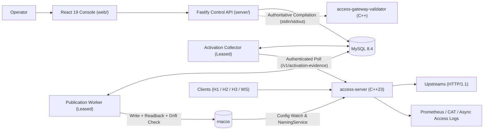

# Access Gateway — Project Evaluation & Summary

**Evaluated revision:** `4932be3` (`docs: mark Access Gateway as running in production`, 224 commits)  
**Pinned upstream submodule:** `third_party/fiber-gateway-cpp` @ `47d84785` (1 local glibc 2.17 compatibility patch)  
**Evaluation date:** 2026-11-26

---

## 1. Executive Summary

**Access Gateway** is a self-hosted, full-stack HTTP/HTTPS/HTTP3 gateway platform composed of two first-class subsystems:

1. **`access-server` (`native/access-server/`)**: A high-performance C++23 data plane built on the pinned `fiber-gateway-cpp` framework. It evolved from a Java (`ploto-unified-access`) gateway migration, preserves its wire compatibility contract, and adds modern capabilities including HTTP/1.1, HTTP/2, HTTP/3 (QUIC), dynamic SNI TLS certificate snapshots, compiled JavaScript-like route scripts, generic Edge Functions, prewarmed upgrades (`access-server-boss`), bounded Prometheus metrics, CAT tracing, and authenticated activation evidence.
2. **Management Console (`server/` + `web/`)**: A Fastify (Node.js/TypeScript) control plane with MySQL 8.4 persistence and a React 19 + CodeMirror 6 frontend. It provides encrypted immutable configuration versions, three-stage validation backed by the real C++ Native Validator binary, leased rnacos publication with drift detection, independent per-instance activation evidence collection, TLS certificate inventory/release management, and a WAF policy engine that compiles cleanly into data-plane edge functions.

> **Overall Verdict: Production-grade data plane engineering; pre-production control plane.**  
> The C++23 data plane exhibits exceptional systems-engineering discipline—immutable snapshots, lock-free request pinning, move-only publication typestates, bounded observability, and 597/597 passing focused tests. The Console architecture is equally well-structured, **but cannot yet be deployed as a standalone production control plane** due to missing OIDC authentication, local-only encryption key management, lack of Nacos credential resolution in the publication worker, and missing audit/RBAC administration surfaces.

### Scorecard

| Dimension                     |    Rating    | Summary                                                                                                                                                                                                    |
| ----------------------------- | :----------: | ---------------------------------------------------------------------------------------------------------------------------------------------------------------------------------------------------------- |
| **System Architecture**       | **9.5 / 10** | Crisp separation of Draft / Published / Active states; zero cross-boundary coupling; native codec as single source of truth; zero-policy data-plane WAF layering.                                          |
| **Data Plane (`native/`)**    | **9.0 / 10** | C++23 `-fno-exceptions`, single Nacos owner loop, worker-sharded SWRR (8–10x 4-worker speedup), 597 passing tests; minor open P1 API/budget cleanup items.                                                 |
| **Control Plane (`server/`)** | **8.0 / 10** | Strong distributed locking (`FOR UPDATE SKIP LOCKED`), AES-256-GCM envelope encryption, fail-closed subprocess validator, 245/246 tests; blocked on OIDC, KMS, and Nacos auth.                             |
| **Frontend Console (`web/`)** | **7.5 / 10** | Clean React 19 + CodeMirror 6 editors, strong runtime API validation, redesigned overview/top-nav; Chinese-only UI (except `/docs`), limited UI test breadth, manual 1,333-LOC type guards.                |
| **Security Posture**          | **7.0 / 10** | Strong fail-closed validation, secret redaction, SSRF/path/size caps, RE2 linear-time regex; gaps in Console production auth/KMS/Nacos creds, unauthenticated `/metrics`, no script VM instruction budget. |
| **Testing & Quality**         | **8.5 / 10** | ~898 automated tests across C++, Node, and Vitest; only 1 `TODO` across ~122k LOC; 2 local hygiene issues caught during live run (stale validator binary, 2 Prettier doc warnings).                        |
| **Operational Readiness**     | **7.5 / 10** | Reproducible Docker Compose demo, Grafana dashboards, prewarmed boss upgrades, fail-closed cutover gate script (`verify_cutover_evidence.py`); formal cutover gate artifacts remain `NOT_MET`.             |

---

## 2. Codebase Overview & Quantitative Footprint

| Subsystem                    | Tech Stack                                     |   Files | Lines of Code | Role                                                               |
| ---------------------------- | ---------------------------------------------- | ------: | ------------: | ------------------------------------------------------------------ |
| `native/access-server/src`   | C++23, CMake 4.1, Fiber                        |     201 |        36,908 | Data plane, offline validator, boss supervisor, control CLI        |
| `native/access-server/tests` | GoogleTest, CTest, Python                      |      61 |        28,582 | 55 `*Test.cpp` suites, Java compat fixtures, cutover gate tests    |
| `server/src`                 | Node >=20.19, TypeScript 7, Fastify 5, mysql2  |     151 |        28,385 | Control-plane API, publication worker, activation collector        |
| `server/migrations`          | MySQL 8.4 SQL                                  |      14 |           901 | Checksum-protected deterministic schema migrations (`0001`–`0014`) |
| `web/src`                    | React 19, Vite 8, React Router 8, CodeMirror 6 |      46 |        17,378 | Management console UI, YAML/JS editors, WAF/TLS/Release workflows  |
| `docs`                       | Markdown + HTML generator (`marked`)           |      25 |         8,867 | Architecture, design specs, bilingual (EN / zh-CN) user guides     |
| `deploy`                     | Docker, Compose, Shell, Grafana JSON           |      12 |           379 | Multi-stage Dockerfile, local demo stack, 2 Grafana dashboards     |
| **Total**                    |                                                | **510** |   **121,400** | _(Excludes `third_party/fiber-gateway-cpp` and build artifacts)_   |

Code hygiene is unusually high: a repo-wide scan found only **one** `TODO` comment in the entire codebase ([`AccessWorkerResources.cpp`](../native/access-server/src/runtime/AccessWorkerResources.cpp#L93)).

---

## 3. Architecture & Component Evaluation

### 3.1 Cross-Component Architecture

Three foundational architectural invariants set this project apart from typical internal gateways:

1. **Strict Lifecycle Separation (Draft != Published != Active):**  
   The control plane never conflates a saved configuration version (MySQL) with a verified rnacos write/readback (Publication Worker) or proven data-plane adoption (Activation Collector). If evidence is missing or exceeds its TTL, status degrades to `unknown` rather than falsely claiming `active`.
2. **Single Source of Truth via Offline Native Validator:**  
   Instead of re-implementing C++ coercion/compiler rules in TypeScript, the Console spawns [`SubprocessNativeValidator`](../server/src/integrations/native-validator/subprocess.ts) (`access-gateway-validator`) with strict byte caps, timeouts, and `shell: false`. At startup, the Console probes `--describe-config-limits` (currently `schema_version = 6`) so browser, API, and data plane enforce identical limits.
3. **Zero-Policy Data Plane for WAF:**  
   `access-server` has no WAF-specific code. The Console compiles WAF rule groups, scopes, exemptions, and per-project `off`/`log`/`block` overrides deterministically into restricted Fiber edge-function scripts ([`generator.ts`](../server/src/modules/waf/generator.ts)) with rule-to-byte-offset source maps so native compiler errors map back to individual WAF rules in the UI.

---

### 3.2 Data Plane (`native/access-server/`)

**Key Strengths**

- **Concurrency & Ownership Model:** All configuration watchers, subscriptions, version tracking, and snapshot compilation run inline on a single Nacos owner EventLoop, eliminating compilation thread pools and cross-loop locking on the config path. Request workers pin immutable `AccessRouteSnapshot` instances with zero locks on the hot path.
- **Compile-Time Safety (`-fno-exceptions` + Typestate):** Expected errors propagate through `std::expected` / `Result` types without C++ exceptions. Project publication uses move-only typestate transitions (`CompiledProjectConfig` -> `PreparedProjectUpdate` -> `ReadyProjectUpdate` -> `commit()`), making it impossible at compile time to publish routes before service discovery is ready.
- **Measured Performance Engineering:** Comprehensive 10-target microbenchmark suite ([`benchmark-baselines.md`](../native/access-server/docs/benchmark-baselines.md)) with SHA-256 source/result manifests. Worker-sharded SWRR service selection (`P-01`) eliminated multi-worker contention, delivering **8.0x–10.1x** higher 4-worker throughput (~52.7M select ops/s @ 1 endpoint, ~8.87M ops/s @ 128 endpoints, ~80–86% scaling efficiency). Worker-local route lookup achieves ~21.8M ops/s across 352 projects / 1,056 routes.
- **Operational Safety:** Fail-closed cold startup (waits for valid Project list, routes, and TLS snapshot before binding/registering in Nacos); fail-safe hot updates (invalid candidates retain the last-known-good snapshot); strict reverse-dependency shutdown ordering; prewarmed upgrades via `access-server-boss` and `access-serverctl`; bounded-cardinality Prometheus metrics with LRU eviction; non-blocking async log channel with drop counters.
- **Disciplined Upstream Provenance:** [`UPSTREAM.md`](../native/access-server/UPSTREAM.md) maintains a commit-by-commit audit trail for every Fiber submodule bump, and [`native/patches/README.md`](../native/patches/README.md) strictly pins the single active patch (`0001-script-regex-avoid-thread-local-destructors.patch` for CentOS 7 / glibc 2.17 compatibility) with a guard script refusing to apply on mismatched revisions.

**Limitations & Open Technical Debt**

- Upstream connections are HTTP/1.1 only; WebSocket upgrades require HTTP/1.1 clients.
- Script routes reject chunked/unknown-length request bodies (`413`) and their `http` directive does not resolve NamingService upstreams.
- Edge functions cannot mutate requests and have no VM instruction budget (relying on static dialect restrictions—no `while`, recursion, or user functions—and RE2 linear-time regex).
- Prewarmed upgrades still have a brief TCP handover window, and HTTP/3 UDP `SO_REUSEPORT` overlap can cause transient H3 failures during rollout.
- Several P1 items from the August 2026 internal review ([`code-architecture-api-review.md`](../native/access-server/docs/code-architecture-api-review.md)) remain open in code (detailed in Section 6).

---

### 3.3 Control Plane (`server/`)

**Key Strengths**

- **Clean Modular Architecture:** Application factory ([`app.ts`](../server/src/app.ts)) is decoupled from process startup so tests use Fastify injection with zero external dependencies (MySQL/rnacos/network). Domain modules (`activation`, `audit`, `auth`, `certificates`, `drafts`, `environments`, `projects`, `publication`, `releases`, `system`, `tls`, `versions`, `waf`) keep SQL in repositories and business transactions in services.
- **Strict Environment Parsing:** [`env.ts`](../server/src/config/env.ts) centralizes all configuration validation with tight numeric bounds, URL sanitization, cross-field invariants (e.g., `ACTIVATION_EVIDENCE_TTL_MILLIS > ACTIVATION_POLL_INTERVAL_MILLIS`), and fail-closed refusal to run `AUTH_MODE=development` under `NODE_ENV=production`.
- **Reliable Distributed Workers:** Both [`PublicationWorker`](../server/src/modules/publication/worker.ts) and the Activation Collector run as separate stateless processes using MySQL `FOR UPDATE SKIP LOCKED`, per-environment lease tables with heartbeats, ordered resource dependency edges, and baseline SHA-256 drift detection (halting with `conflict` instead of clobbering out-of-band rnacos edits).
- **Encryption at Rest:** [`LocalEnvelopeDocumentCipher`](../server/src/crypto/document-cipher.ts) implements AES-256-GCM envelope encryption (fresh 32-byte DEK per document wrapped with the master KEK) for configuration documents and TLS private keys, with no private-key download API.

**Limitations & Production Blockers**

- **No Production Auth (OIDC):** [`auth/service.ts`](../server/src/modules/auth/service.ts) only implements `FixedActorAuthService` (`development`) and `UnavailableAuthService`; `AUTH_MODE=oidc` is not implemented.
- **No Nacos Authentication in Publication Worker:** [`HttpNacosClient`](../server/src/integrations/nacos/http.ts#L26-L33) explicitly throws `NACOS_CREDENTIAL_PROVIDER_UNAVAILABLE` whenever `target.credentialConfigured` is true—blocking deployment against authenticated production Nacos/rnacos clusters.
- **No External KMS or Key Rotation Ring:** `LocalEnvelopeDocumentCipher` accepts a single local `keyId` and rejects decryption of documents encrypted under any previous key ID, preventing zero-downtime KEK rotation.
- **Incomplete Self-Service & Operational Surfaces:** Audit events are persisted ([`audit/repository.ts`](../server/src/modules/audit/repository.ts)) with no read API/UI; RBAC role memberships have no management API/UI; failed/partial releases have no per-resource retry; TLS releases lack one-click rollback; removed edge-function script Data IDs remain as orphans in rnacos; gray rules and Host entry-network restrictions are not yet editable in Console.

---

### 3.4 Management Console Frontend (`web/`)

**Key Strengths**

- **Modern Stack & Workflow UX:** Built on React 19, Vite 8, React Router 8, and CodeMirror 6 ([`YamlCodeEditor.tsx`](../web/src/components/YamlCodeEditor.tsx)) supporting both YAML and JavaScript route authoring, drag/keyboard reordering, exact wire-output previews, unsaved-change guards (`useUnsavedChangesGuard`), and a recently redesigned top-navigation shell ([`AppShell.tsx`](../web/src/components/AppShell.tsx)) with live dependency health indicators.
- **Defensive Client Boundary:** [`client.ts`](../web/src/api/client.ts) validates API responses at runtime with explicit type guards, preventing silent schema drift between server and browser.
- **Integrated Bilingual Documentation:** `/docs` lazy-loads compiled EN and zh-CN route/script guides verified in CI via `docs:check`.

**Limitations**

- **Single-Language Console Chrome:** While `/docs` is bilingual, the Console UI itself is hard-coded in Simplified Chinese without an i18n layer.
- **Maintenance Overhead of Manual Type Guards:** `web/src/api/client.ts` is 1,333 lines of hand-written structural guards (including hardcoded `schemaVersion !== 6`), creating friction when evolving contracts.
- **UI Test Depth:** Automated UI coverage currently spans 3 test files (39 Vitest tests + 14 route model tests), leaving several complex workflow pages (e.g., Certificates, Releases, Network/Host policy, Overview) without dedicated component-level interaction tests.

---

## 4. Live Verification & Health Check Results

The following validation suite was executed directly against the repository at `4932be3`:

| Check                     | Command                                                              |    Result     | Details                                                                                                                                                              |
| ------------------------- | -------------------------------------------------------------------- | :-----------: | -------------------------------------------------------------------------------------------------------------------------------------------------------------------- |
| **TypeScript Typecheck**  | `npm run typecheck`                                                  |   **PASS**    | Strict `tsc` passed cleanly for both `web` and `server`.                                                                                                             |
| **Native Focused Tests**  | `ctest --test-dir native/build --output-on-failure -L access-server` |   **PASS**    | **597 / 597** passed in 22.35s (2 opt-in external tests skipped: `InteropServerMode`, `CompilesExternalSnapshotWhenProvided`).                                       |
| **Web Tests**             | `npm test --workspace web`                                           |   **PASS**    | User guide check passed; **14 / 14** route model tests + **39 / 39** Vitest UI tests passed (3 files; minor jsdom `getClientRects` stderr warnings from CodeMirror). |
| **Server Tests**          | `npm test --workspace server`                                        | **245 / 246** | **1 failure** in [`generator.test.ts`](../server/src/modules/waf/generator.test.ts#L348-L379) (`every golden script compiles with the real native validator`).       |
| **Prettier Format Check** | `npm run format:check`                                               |   **FAIL**    | 2 documentation files have formatting drift: [`architecture.md`](architecture.md) and [`edge-functions-and-waf-design.md`](edge-functions-and-waf-design.md).        |

> **Root cause of the single server test failure:**  
> `generator.test.ts` auto-discovers `native/build/apps/access-gateway-validator` if present on disk. In the evaluated workspace, `native/build/apps/access-server` had been rebuilt on **Nov 11**, while `native/build/apps/access-gateway-validator` was stale from **Sep 2** (predating the `edge_function_script` validator kind), causing it to reject the test payload with `validator kind is not supported`. Running `npm run build:native-validator` before `npm test` resolves this; CI and local scripts should avoid leaving the two native targets out of sync.

---

## 5. Security & Trust Boundary Assessment

### What Is Done Well

- **Single-Parse Client Identity (`ClientMetadata`):** `direct` (default), `trusted_proxy` (CIDR-gated right-to-left hop stripping), and `legacy_headers` modes ensure HTTPS redirects, route CIDRs, gray matching, and logging never disagree on the client IP/scheme. `X-Entry` is strictly server-synthesized from mandatory `ACCESS_SERVER_NETWORK_ENTRY`.
- **Fail-Closed Validation & Input Bounds:** Resource limits (`AccessConfigLimits`) cap payload bytes, hosts, routes, CIDRs, scripts, and static bodies before allocation. Subprocess validator enforces `shell: false`, byte limits, and `SIGKILL` deadlines.
- **DoS Hardening:** Linear-time RE2 regex engine eliminates ReDoS in WAF/edge functions; buffered proxy pipes coalesce trickled reads; bounded DNS and async log queues prevent memory exhaustion and backpressure.
- **Secret Hygiene:** AES-256-GCM envelope encryption for stored configs/keys; client mTLS certificates referenced by UUID so private keys never appear in route JSON; redacted error/audit outputs.

### Key Security Risks to Address

1. **Console Production Auth & KMS Gap (Critical for Console prod):** No OIDC provider and no external KMS / key rotation ring.
2. **Unauthenticated Nacos Publication (Critical for Console prod):** [`HttpNacosClient`](../server/src/integrations/nacos/http.ts) cannot authenticate to Nacos/rnacos when credentials are configured.
3. **Unsafe Data-Plane Default for Upstream TLS:** `ACCESS_SERVER_UPSTREAM_TLS_MODE` defaults to `legacy_insecure` (no certificate verification) for Java compatibility; misconfigured deployments could silently skip upstream cert checks unless explicitly overridden.
4. **No Script VM Instruction Budget:** While the script dialect omits `while` and recursion, deeply nested container iterations or heavy regex chains across up to 64 edge functions could still spike per-request CPU without a hard instruction/fuel cap.
5. **Unauthenticated `/metrics` Listener:** Relies purely on network isolation of port `8001` (whereas `/v1/activation-evidence` on the same listener requires a Bearer token).

---

## 6. Technical Debt, Documentation Drift & Workspace Observations

Live code inspection surfaced several concrete drift items between documentation, reviews, and current code:

1. **Production Status vs. Cutover Gate Contradiction:**  
   Commit `4932be3` updated [`README.md`](../README.md#L20-L28) to declare Access Gateway "running in production", whereas [`AGENTS.md`](../AGENTS.md#L27-L31), [`architecture.md`](architecture.md#L317), and [`cutover-evidence-gate.md`](../native/access-server/docs/cutover-evidence-gate.md#L10-L11) still state that production script-corpus differential verification and cutover gates are unfinished (`NOT_MET`). These should be reconciled to reflect actual production governance state.
2. **Upstream TLS Connection Pool Isolation Drift:**  
   [`architecture.md`](architecture.md#L220) claims every `upstream_tls` profile maintains an isolated connection-pool affinity so rotating a generation never reuses old connections. However, [`UPSTREAM.md`](../native/access-server/UPSTREAM.md#L360-L365) documents that upstream Fiber removed `HttpConnectionPoolAffinity` in pin `7da6926ee410`, meaning pooled connections can temporarily be reused across TLS profile rotations until drained.
3. **Open Native P1 Items from August 2026 Review:**
   - **Body-limit default mismatch:** [`AccessServer.h`](../native/access-server/src/runtime/AccessServer.h#L31) defaults `default_max_request_body_size` to **400 MiB**, whereas [`AccessRequestHandler.h`](../native/access-server/src/execution/AccessRequestHandler.h#L52) defaults to **4 MiB**.
   - **Missing global aggregate snapshot budget:** [`AccessRouteSnapshot.cpp`](../native/access-server/src/routing/AccessRouteSnapshot.cpp#L42-L46) sums `host_count_`, `route_count_`, `compiled_program_count_`, and `estimated_memory_bytes_` across all projects, but enforces no aggregate ceiling (only per-project limits and `max_projects = 1024`).
   - **Wide data-plane dependency:** [`AccessServer.h`](../native/access-server/src/runtime/AccessServer.h#L52) still accepts `const RouteConfigStore &` instead of a narrow read-only `AccessDataPlaneDependencies` bundle.
4. **Workspace Build & Temp Clutter:**  
   Multiple local native build trees (`build`, `build-benchmarks`, `build-codex`, `build-sync-check`, `build-validator-codex`) and a `temp/` directory with local MySQL data/logs can accumulate locally. While git-ignored, stale binaries in `native/build/` directly caused the `generator.test.ts` failure above.

---

## 7. Prioritized Recommendations

### P0 — Console Production Readiness Blockers

1. **Implement OIDC Authentication Adapter:** Complete `AUTH_MODE=oidc` with session/JWT validation and RBAC role mapping so `NODE_ENV=production` is deployable.
2. **Implement Nacos Credential Provider:** Replace the stub throw in [`HttpNacosClient`](../server/src/integrations/nacos/http.ts) with authenticated Nacos/rnacos login/token handling and secret resolution.
3. **Add External KMS & Multi-Key Decryption Ring:** Extend `DocumentCipher` to support external KMS wrapping and multiple active/retired `keyId`s for safe KEK rotation.

### P1 — Reliability, Security & Native Hardening

4. **Enforce Global Snapshot Aggregate Budgets & Unify Body-Limit Constants:** Add checked aggregate caps in [`AccessRouteSnapshot.cpp`](../native/access-server/src/routing/AccessRouteSnapshot.cpp) and extract a single canonical `kDefaultMaxRequestBodySize` across `AccessServer` and `AccessRequestHandler`.
5. **Restore Upstream TLS Pool Discriminator:** Follow up upstream in `fiber-gateway-cpp` to reintroduce TLS profile pool isolation (or update [`architecture.md`](architecture.md#L220) immediately to accurately document the current drain-window behavior).
6. **Add Script VM Instruction / Execution Budget:** Bound worst-case CPU per edge-function / route-script invocation in the Fiber script VM to harden against accidental or malicious expensive scripts.
7. **Complete Operational Console Gaps:** Add Audit Log viewer API/UI, RBAC membership management, TLS release one-click rollback, and Gray Rules / Host entry-network editors.

### P2 — Engineering Hygiene & Developer Experience

8. **Fix Immediate CI/Local Hygiene:** Run `npm run format` on the two drifted docs, rebuild `npm run build:native-validator` (or bundle `access-server` + `access-gateway-validator` into a single `build:native:all` target), and reconcile production status wording across `README.md`, `AGENTS.md`, and `docs/architecture.md`.
9. **Upstream the glibc 2.17 Regex Cache Patch:** Eliminate `native/patches/0001` on the next Fiber pin update so `third_party/fiber-gateway-cpp` stays completely clean.
10. **Reduce Frontend API Boilerplate & Expand UI Tests:** Consider generating or schema-deriving the 1,333-line runtime guards in [`web/src/api/client.ts`](../web/src/api/client.ts), and add Vitest UI coverage for Certificates, Releases, and Overview pages.
